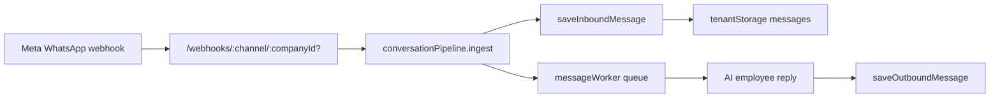
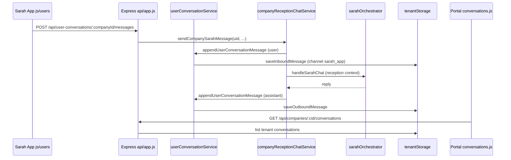
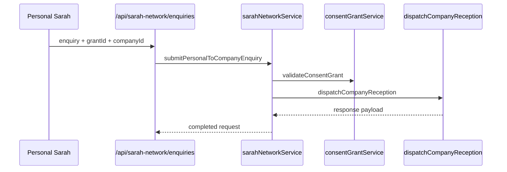
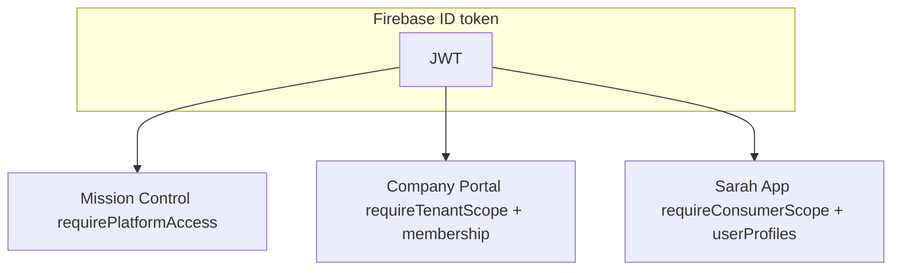

# Company Portal ↔ Sarah App — C0 Read-Only Integration Audit

**Document:** `COMPANY_PORTAL_SARAH_APP_INTEGRATION_AUDIT.md`  
**Phase:** **C0** — read-only codebase audit (no commits, deploys, or branch switches)  
**Audit date:** 2026-11-08  
**Programme context:** [SARAH_APP_MASTER_ARCHITECTURE.md](./SARAH_APP_MASTER_ARCHITECTURE.md), [SARAH_APP_GATE1_GIT_RECONCILIATION_PLAN.md](./SARAH_APP_GATE1_GIT_RECONCILIATION_PLAN.md)

---

## 1. Executive summary

Sarah App consumer APIs (U1–U5) and Revenue R0 are **implemented on the Railway/Express host** (`api/app.js`) with a parallel **production consumer shell** under `js/users/` and a **UX prototype** under `prototype/sarah-app-ux/`. Company Portal remains the **tenant business OS** on `app/` (mirrored from `js/portal/` via `scripts/prepare-sites.js`).

**Integration posture today:** Consumer ↔ Company Sarah chat **reuses** the tenant conversation pipeline (`channel: sarah_app`) but stores the **consumer conversation index in process memory** (`userConversationService.js`), not yet in Firestore `userConversations/` as specified in [SARAH_APP_DATA_ARCHITECTURE.md](./SARAH_APP_DATA_ARCHITECTURE.md). Discover is a **pilot in-memory directory**; Status/Discover/Chats UX in the prototype are **mostly mock**. Company Portal inbox is **WhatsApp-first** with no dedicated `sarah_app` channel label in UI.

**Critical gaps before production bridge:** durable consumer conversation store, `businessDirectory` in Firestore, `personId` model for P2P chats (C03 UX), portal discover/subscriber modules (SUB-01/BP-01), and unified identity keys across Firebase `uid`, tenant `sarah_app::{uid}`, and WhatsApp phone-backed IDs.

---

## 2. Company Portal — modules inventory

### 2.1 Navigation shell

Sidebar and lazy-loaded modules are defined in:

| Concern | Path |
|---------|------|
| Nav sections (Operate / Grow / Admin) | `app/js/portal/core/appShell.js` (`NAV_SECTIONS`) |
| Module lazy load map | `app/js/portal/core/lazyLoader.js` (`MODULE_IDS`, `EXPORT_MAP`) |
| Routing + RBAC gate | `app/js/portal/router.js` (`canAccessModule`) |
| Portal API client | `app/js/portal/api.js` (mirror: `js/portal/api.js`) |

**Core BOS modules (lazy loader):** `dashboard`, `sarah`, `agents`, `knowledge`, `customers`, `conversations`, `appointments`, `operations`, `automation`, `analytics`, `marketplace`, `billing`, `integrations`, `settings`, `notifications`, `support`, `team`, `activity`.

**Industry / finance extensions (present in tree, not in default `MODULE_IDS`):** dental command centre, automotive command centre, finance workspaces — e.g. `app/js/portal/modules/dentalBookings.js`, `dentalPos.js`, `finance.js`, `automotiveCommandCentre.js`, plus shells in `app/js/portal/financeWorkspaceShells.js`.

### 2.2 Sarah workforce surfaces (portal)

| Surface | Path |
|---------|------|
| Module-scoped Sarah UI | `app/js/portal/modules/sarah.js`, `app/js/portal/sarah/sarah-chat.js` |
| Surface → prompt mapping | `app/js/portal/sarah/sarahModuleSurfaces.js` |
| System prompt / portal copy | `services/sarah/prompts/systemPrompt.js`, `services/sarah/portalSarahSurfaces.js` |
| Portal navigation tool | `services/sarah/tools/navigatePortal.js` |

Company Portal Sarah operates as **`CLIENT_OPERATOR`** persona with tenant tools; this is **not** the same code path as consumer **Company Reception** (`services/sarah/company/companyReceptionChatService.js`).

### 2.2 Portal data hub

Unified workspace reads aggregate CRM, inbox, analytics, and BOS snapshots via `services/portal/portalDataHub.js` and `GET /api/portal/hub/:companyId` (catalogued in `services/api/routeRegistry.js`).

---

## 3. WhatsApp inbox (Company Portal)

### 3.1 UI

| Layer | Path |
|-------|------|
| Inbox page | `app/js/portal/modules/conversations.js` |
| Shared inbox layout / filters | `app/js/portal/modules/inbox-ui.js` |
| Permissions | `canViewInbox` / `canReply` in `app/js/portal/permissions.js` |

Channel labels in inbox UI: `whatsapp`, `facebook`, `instagram`, `telegram`, `webchat`, `email`, `sms` — **no `sarah_app` entry** (`CHANNEL_LABELS` in `inbox-ui.js`). Sarah App threads may appear as WhatsApp-default labelling if `channel` is unset.

### 3.2 API

| Operation | Route | Implementation |
|-----------|-------|------------------|
| List inbox | `GET /api/companies/:companyId/conversations` | `services/api/customerOpsRoutes.js` |
| Thread detail | `GET /api/companies/:companyId/conversations/:conversationId` | same |
| Human reply | `POST .../reply` | `requireAuthenticatedTenantMember()` |
| Takeover / read | `POST .../takeover`, `.../read` | same |

Client: `fetchTenantConversations`, `fetchConversationDetail`, etc. in `app/js/portal/api.js`.

### 3.3 Ingestion pipeline

Key files: `services/integrations/conversationPipeline.js`, `services/queue/workers/messageWorker.js`, `services/whatsapp.js`, `services/storage/tenantStorage.js`.

**Tenant conversation id (WhatsApp):** `conversationDocId(phone, "whatsapp")` → `whatsapp::{normalizedPhone}` (`tenantStorage.js`).

---

## 4. Company Sarah

### 4.1 Consumer-facing (Sarah App channel)

| Piece | Path |
|-------|------|
| Chat orchestration | `services/sarah/company/companyReceptionChatService.js` |
| Reception context / KB digest | `services/sarah/network/companyReceptionContext.js` |
| LLM entry | `services/sarah/sarahOrchestrator.js` (`handleSarahChat`) |

**Flow:** `POST /api/user-conversations/:companyId/messages` → append user message → build reception context → orchestrator reply → mirror to tenant storage via `userConversationService.appendUserConversationMessage`.

### 4.2 Tenant mirror

On each message, `userConversationService.js` calls `saveInboundMessage` / `saveOutboundMessage` with:

- `channel: "sarah_app"`
- `externalUserId`: Firebase consumer `uid`
- Customer doc id: `sarah_app::{sanitizedUid}` (`resolveSarahAppCustomerId` in `tenantStorage.js`)
- Tenant conversation id: `sarah_app::sarah_app::{uid}` pattern via `conversationDocId(customerId, "sarah_app")`

### 4.3 Portal-facing Company Sarah

Portal operators use `POST /api/sarah/chat` with tenant session store `companies/{companyId}/sarahSessions/` (`services/sarah/sarahSessionStore.js`). Consumer routes **must not** expose this endpoint without `requireConsumerScope()` separation (per master architecture).

---

## 5. Personal Sarah APIs

Mounted in `api/app.js` via `mountPersonalSarahRoutes` / `mountPersonalKnowledgeRoutes`.

| Route | Handler | Path |
|-------|---------|------|
| `POST /api/personal-sarah/chat` | Quota + session ownership | `services/api/personalSarahRoutes.js` |
| `GET/POST /api/personal-sarah/sessions*` | Session CRUD | same + `services/sarah/personal/personalSarahSessionStore.js` |
| `GET/PUT /api/personal-knowledge/sections/*` | My Knowledge | `services/api/personalKnowledgeRoutes.js` |

**Auth:** `requireConsumerScope()` (`services/auth/consumerAuth.js`) — requires `userProfiles/{uid}`.

**Orchestration:** `services/sarah/personal/personalSarahOrchestrator.js`, tools in `services/sarah/personal/personalSarahTools.js`.

**Consumer bootstrap:** `POST /api/users/bootstrap`, profile CRUD in `services/api/consumerRoutes.js` → `services/users/consumerProfileService.js`.

**Production UI:** `js/users/modules/mySarah.js`, `js/users/personalSarahChat.js`.  
**Prototype live bridge:** `prototype/sarah-app-ux/js/live-bridge.mjs` (Personal Sarah only; Chats/Discover not wired).

---

## 6. Sarah Network

### 6.1 API (U4)

`services/api/sarahNetworkRoutes.js`:

- `POST /api/sarah-network/grants` — `consentGrantService.js`
- `POST /api/sarah-network/enquiries` — `sarahNetworkService.submitPersonalToCompanyEnquiry`
- `GET /api/sarah-network/requests*`

### 6.2 Orchestration

| Piece | Path |
|-------|------|
| Rate limit + grant validation | `services/sarah/network/sarahNetworkService.js` |
| Request store (memory) | `services/sarah/network/sarahNetworkStore.js` |
| Company dispatch | `services/sarah/network/dispatchCompanyReception.js` |
| Schema constants | `services/database/schema.js` (`SARAH_NETWORK`) |
| Protocol doc | `docs/architecture/SARAH_NETWORK_PROTOCOL.md` |

Enquiries require a **consent grant** tied to `companyId` before dispatch — aligned with [SARAH_APP_TRUST_AND_CONSENT.md](./SARAH_APP_TRUST_AND_CONSENT.md).

---

## 7. Status, Discover, Chats — `sarah-app-ux`

### 7.1 Prototype (`prototype/sarah-app-ux/`)

| Surface | Hash routes | Data source | Path |
|---------|-------------|-------------|------|
| Status (feed) | `#status` | Mock `MOCK_FEED` | `js/app.js`, `js/mock-data.js` |
| Discover | `#discover`, `#discover/{id}` | Mock companies (e.g. green-haven) | same; comment at `app.js` ~7374: client-only until U6 API |
| Chats inbox | `#chats`, `#chat-thread` | Mock + **no live bridge** for company threads | `js/app.js` |
| Personal Sarah | `#home`, `#chat-thread` | **Live** via `live-bridge.mjs` when HTTP + Firebase | `js/live-bridge.mjs` |
| My Organisations (SUB-01) | `#home/organisations` | localStorage + mock | `README.md` |
| My Wallet / Sarah Pay | `#home/wallet`, `#home/pay` | Mock only | spec docs MW-01, SYP-01 |

README: `prototype/sarah-app-ux/README.md` — explicitly **not production**; do not deploy to `sarah.ziricai.com` until UX approval.

### 7.2 Production consumer shell (`js/users/`)

| Module | API wiring | Path |
|--------|------------|------|
| Chats | Live U5 | `js/users/modules/chats.js`, `js/users/companyChat.js` |
| Discover | `GET /api/discover/companies` | `js/users/modules/discover.js` |
| Status | Placeholder | `js/users/modules/placeholders.js` (per programme docs) |

Discover API returns **pilot company ids** from env `SARAH_NETWORK_PILOT_COMPANY_IDS` / SmileMore default — not full U6 directory.

---

## 8. Subscribers (My Organisations — SUB-01)

**Specification only** for Company Portal “Subscriber Management” and consumer “My Organisations”: [SARAH_APP_SUB01_MY_ORGANISATIONS_FUNCTIONAL_SPEC.md](./SARAH_APP_SUB01_MY_ORGANISATIONS_FUNCTIONAL_SPEC.md).

**Codebase findings:**

- No `services/**` module for verified subscriber relationships or org→user broadcast.
- Prototype state: `localStorage` keys documented in `prototype/sarah-app-ux/README.md`.
- Tenant `subscriptions` collection in schema (`TENANT_COLLECTIONS.SUBSCRIPTIONS` in `services/database/schema.js`) refers to **tenant billing/subscription**, not Sarah App “subscriber” semantics.

**Reuse vs build:** Extend Sarah Network grants + future `userCompanies/{uid}/connections/` (data architecture) rather than overloading tenant `subscriptions`.

---

## 9. Bookings and payments

### 9.1 Appointments (tenant — reuse)

| Layer | Path |
|-------|------|
| API | `GET/POST/PATCH /api/companies/:companyId/appointments*` in `services/api/customerOpsRoutes.js` |
| Service | `services/tenants/appointmentService.js` |
| Portal UI | `app/js/portal/modules/appointments.js` |
| Dental bookings (vertical) | `app/js/portal/modules/dentalBookings.js` |

Appointment creation publishes `EventTypes.APPOINTMENT_BOOKED` via `services/events/eventBus.js`.

**Sarah App:** Booking execution from Personal/Company Sarah is **consent-gated** (identity doc) — no consumer booking API yet.

### 9.2 Payments

| Domain | Implementation | Path |
|--------|----------------|------|
| Tenant finance ledger / invoices | Finance routes + portal UI | `services/api/financeRoutes.js`, `app/js/portal/modules/finance.js` |
| Invoice payments | `POST .../invoices/:invoiceId/payments` | `financeRoutes.js` → events `PaymentReceived` / `PaymentFailed` |
| Platform revenue (R0) | Consumer entitlements, catalogue | `services/revenue/*`, `services/api/revenueRoutes.js`, `platformRevenueRoutes.js` |
| Sarah Pay / My Wallet | **Spec + prototype mock only** | SYP-01, MW-01 docs; `prototype/sarah-app-ux/js/mock-data.js` |
| Plan catalog (no PSP) | `GET /api/billing/plans` | `routeRegistry.js` |

Consumer payment execution and wallet balances are **not** integrated with Company Portal finance modules in code.

---

## 10. Analytics events

### 10.1 Canonical types

`services/events/eventTypes.js` — e.g. `MessageReceived`, `MessageSent`, `ConversationStarted`, `AppointmentBooked`, `PaymentReceived`, `SubscriptionStarted`, `KnowledgeQuery`, BOS cycle events.

### 10.2 Persistence and APIs

| Layer | Path |
|-------|------|
| Publish | `services/events/eventBus.js` (`publish(companyId, type, payload)`) |
| Tenant storage | `companies/{companyId}/events/`, analytics subcollections — `services/database/schema.js` (`EVENTS`, `ANALYTICS_SUBCOLLECTIONS`) |
| Portal read | `GET /api/analytics/dashboard/:companyId`, `GET /api/analytics/events/:companyId` |
| Portal module | `app/js/portal/modules/analytics.js` |
| Audit (cross-cutting) | `services/audit/auditLog.js` — consumer/company Sarah, network, bootstrap |

**Gap:** No first-class **consumer analytics** event stream for Status/Discover engagement (U6/U7); prototype engagement is local-only in `prototype/sarah-app-ux/js/app.js` (`feedEngagement`).

---

## 11. Tenant RBAC

### 11.1 Company Portal (UI + API)

| Layer | Path |
|-------|------|
| Client matrix | `app/js/portal/permissions.js` (`PERMISSION_MATRIX`, `MODULE_PERMISSIONS`) |
| Server matrix (SEC-04 aligned) | `services/auth/permissionsService.js` |
| Tenant scope | `services/core/tenantContext.js` — `requireTenantScope()`, `requireAuthenticatedTenantMember()` |
| Membership | `companies/{companyId}/users/{uid}` —见 `services/auth/authService.js` (`getTenantMembership`) |
| Enforcement mode | `TENANT_SCOPE_ENFORCEMENT` env (`strict` vs `lax`) |

**Representative permissions:**

- Inbox: `canViewInbox` — owner, manager, sales, support, reception, viewer
- Reply: `canReply` — excludes viewer
- Integrations / WhatsApp: `canManageIntegrations` — owner, manager
- Knowledge upload: `canUploadKnowledge` — **owner only**

### 11.2 Sarah App (consumer)

| Middleware | Path |
|------------|------|
| `requireConsumerScope()` | `services/auth/consumerAuth.js` |
| Bootstrap | `requireFirebaseAuth()` on `/api/users/bootstrap` only |

Consumer routes **do not** use `companyId` from body as authorization (per [SARAH_APP_IDENTITY_AND_ACCESS.md](./SARAH_APP_IDENTITY_AND_ACCESS.md)).

### 11.3 Mission Control / WhatsApp gateway

Platform: `requirePlatformAccess()`; gateway refine: `docs/architecture/G7_1_WHATSAPP_GATEWAY_RBAC.md`, `services/auth/platformAuth.js`.

---

## 12. Reuse vs replace matrix

| Capability | Reuse (current) | Replace / extend |
|------------|-----------------|------------------|
| Firebase Auth | ✅ All portals | Extend `users/{uid}.accountKinds` per identity doc |
| Sarah orchestrator | ✅ Personal + Company Reception | Add personas; **do not** fork LLM stack |
| Tenant conversations/messages | ✅ `sarah_app` channel | Durable **consumer index** (Firestore `userConversations/`) |
| WhatsApp pipeline | ✅ Unchanged for optional channel | Sarah App as default; inbox UI must show `sarah_app` |
| Portal Sarah (`/api/sarah/chat`) | ✅ Operator workforce | Keep separate from consumer Company Sarah |
| CRM customer ids | ✅ Phone (WhatsApp) + `sarah_app::uid` | Link graph when same person uses both channels |
| Discover directory | ⚠️ In-memory pilot | Firestore `businessDirectory/` + portal publish workflow |
| Sarah Network | ⚠️ In-memory requests/grants | Persist to `sarahNetwork/` + rules |
| Status/Discover UX | ❌ Prototype mock | U6/U7 engines per architecture doc |
| SUB-01 subscribers | ❌ Spec only | New collections + portal module |
| My Wallet / Sarah Pay | ❌ Mock | Partner PSP + SYP/MW services |
| `personId` P2P chat | ❌ Not in codebase | New identity layer (C03 UX) |

---

## 13. Identity gap analysis — `personId`, `conversationId`, `messageId`

| Identifier | Intended role (blueprint) | Implemented today | Gap |
|------------|---------------------------|-------------------|-----|
| **Person** | Stable human across portals, P2P chat (UX C03) | **Firebase `uid`** for consumers; **phone** for WhatsApp customers; **`sarah_app::{uid}`** tenant customer id | **`personId` does not exist** in repo (zero matches). P2P threads not implemented. Cross-channel identity (same human on WhatsApp + Sarah App) is **not linked**. |
| **conversationId** | Global consumer thread id; links to tenant CRM | Consumer: `uc_{companyId}_{userId}` in memory (`userConversationService.buildConversationId`). Tenant: `sarah_app::sarah_app::{uid}` or `whatsapp::{phone}`. Optional `tenantConversationId` on consumer conv. | Consumer ids **not durable**; **two id spaces** (consumer `uc_*` vs tenant `channel::customerId`). No `userConversations/` Firestore root despite data architecture doc. |
| **messageId** | Idempotent dedupe + mirror | WhatsApp: Meta `wamid` as `externalId` (`conversationPipeline`). Tenant store: `options.externalId \|\| uid("msg")` (`tenantStorage`). Consumer messages: `randomUUID()` in memory. | Consumer message ids **not stable** across restarts; WhatsApp dedupe **does not apply** to Sarah App channel unless `externalId` added. |

**Recommended canonical model (align with [SARAH_APP_DATA_ARCHITECTURE.md](./SARAH_APP_DATA_ARCHITECTURE.md)):**

1. **Person:** Use Firebase `uid` as person key for registered users; introduce `personId` only if guest/P2P requires non-Auth identities (future C03).
2. **conversationId:** Single primary key in `userConversations/{conversationId}` with `tenantConversationId` + `companyId` + `userId` fields; tenant SoT remains `companies/{cid}/conversations/{id}`.
3. **messageId:** Propagate UUID from consumer write → tenant message doc; support `externalId` for inbound bridges.

---

## 14. Data flow diagrams

### 14.1 Consumer → Company Sarah → Portal inbox

### 14.2 Sarah Network enquiry

### 14.3 Three-portal authorization

---

## 15. API inventory (integration-relevant)

**Source of truth:** `services/api/routeRegistry.js` (`ROUTE_CATALOG`, `routesByDomain()`).

### Consumer domain (`requireConsumerScope` unless noted)

| Method | Path | Module file |
|--------|------|-------------|
| POST | `/api/users/bootstrap` | `consumerRoutes.js` (Firebase auth only) |
| GET/PATCH | `/api/users/profile` | `consumerRoutes.js` |
| POST | `/api/personal-sarah/chat` | `personalSarahRoutes.js` |
| GET/POST | `/api/personal-sarah/sessions*` | `personalSarahRoutes.js` |
| GET/PUT | `/api/personal-knowledge/sections/*` | `personalKnowledgeRoutes.js` |
| POST/GET | `/api/sarah-network/grants*` | `sarahNetworkRoutes.js` |
| POST/GET | `/api/sarah-network/enquiries`, `requests*` | `sarahNetworkRoutes.js` |
| GET | `/api/discover/companies` | `userConversationRoutes.js` |
| GET/POST | `/api/user-conversations*` | `userConversationRoutes.js` |
| GET | `/api/revenue/entitlements/me` | `revenueRoutes.js` |

### Portal / tenant (selection)

| Domain | Example paths | Middleware |
|--------|---------------|------------|
| Inbox | `/api/companies/:companyId/conversations*` | `requireTenantScope` + member for mutations |
| Appointments | `/api/companies/:companyId/appointments*` | `requireTenantScope` |
| Analytics | `/api/analytics/*`, `/api/portal/analytics/*` | `requireTenantScope` |
| Portal Sarah | `/api/sarah/chat` | Tenant + `assertSarahChatAccess` |
| Integrations | `/api/integrations/*`, webhooks | Platform/tenant per route |

### Webhooks (no tenant middleware on ingest)

`GET/POST /webhooks/:channel/:companyId?` — WhatsApp and unified channels (`routeRegistry.js`).

---

## 16. Risks

| Risk | Severity | Evidence | Mitigation |
|------|----------|----------|------------|
| Consumer conversations lost on API restart | **High** | In-memory `userConversationService.js` | Persist `userConversations/` + hydrate on boot |
| Cross-tenant data leak via lax scope | **High** | `TENANT_SCOPE_ENFORCEMENT=lax` default | Strict in prod; keep consumer routes on separate middleware |
| Inbox mislabels Sarah App threads | **Medium** | No `sarah_app` in `inbox-ui.js` | Add channel label + filter |
| Discover pilot-only | **Medium** | `businessDirectoryService.js` in-memory | Firestore directory + portal publish |
| Dual Sarah chat surfaces | **Medium** | `/api/sarah/chat` vs `/api/user-conversations` | Document personas; block consumer from portal route |
| Identity fragmentation | **High** | phone vs uid vs `uc_*` ids | Identity linking service; adopt data architecture paths |
| SUB-01/BP-01 assumed in UX but absent in portal | **Medium** | Spec vs no services | C8 portal slice before marketing SUB-01 |
| Status/Discover ship as mocks | **Medium** | `sarah-app-ux` README | Gate UX approval; U6/U7 backends |
| WhatsApp regression during merge | **High** | Gate 1 reconciliation plan | Keep gateway tests; staged deploy |

---

## 17. C0–C8 sequence (user blueprint)

| Step | Name | Scope | Primary paths | Depends on |
|------|------|-------|---------------|------------|
| **C0** | **Company Portal ↔ Sarah App integration audit** | Read-only; this document | `docs/architecture/COMPANY_PORTAL_SARAH_APP_INTEGRATION_AUDIT.md` | — |
| **C1** | Programme & Phase 0 docs | Architecture, revenue, gate plans | `docs/architecture/SARAH_*`, `docs/audit/sarah-app-*.json` | — |
| **C2** | Sarah consumer foundation U1 | Auth, bootstrap, `users/` shell | `consumerAuth.js`, `consumerRoutes.js`, `js/users/**`, `prepare-sites.js` | C1 optional |
| **C3** | Personal Sarah + My Knowledge U2–U3 | Personal APIs + knowledge | `services/sarah/personal/*`, `personal*Routes.js` | C2 |
| **C4** | Sarah Network + conversations U4–U5 | Network + Company Sarah chat | `services/sarah/network/*`, `company/*`, `userConversation*`, `tenantStorage.js` | C2 |
| **C5** | Revenue R0 | Entitlements, catalogue | `services/revenue/*`, `revenue*Routes.js` | C2 |
| **C6** | API integration | Mount all routes | `api/app.js`, `routeRegistry.js` | Merge main |
| **C7** | Tests | Consumer/network/conversation/revenue | `test/consumer-*`, `test/user-conversations-u5.test.mjs`, etc. | C2–C6 |
| **C8** | **Company Portal integration slice** | Bridge tenant ops to Sarah App **without** merging shells | Portal: discover publish hooks, inbox `sarah_app` channel, integrations health; Spec: SUB-01 portal module, BP-01 company connection authorisation; **no** consumer mock merge | C4, C6 |

**Note:** C1–C7 are copied from [SARAH_APP_GATE1_GIT_RECONCILIATION_PLAN.md](./SARAH_APP_GATE1_GIT_RECONCILIATION_PLAN.md) Task 5. **C8** is the post-U5 **portal-side** work implied by master architecture Q5 and SUB-01/BP-01 — not yet a named commit group in Gate 1.

---

## 18. Reference index (high-signal paths)

| Area | Path |
|------|------|
| API host | `api/app.js`, `api/server.js` |
| Route catalog | `services/api/routeRegistry.js` |
| Firestore schema | `services/database/schema.js` |
| Tenant conversations | `services/storage/tenantStorage.js`, `services/api/customerOpsRoutes.js` |
| Consumer conversations | `services/users/userConversationService.js`, `services/api/userConversationRoutes.js` |
| Company Sarah | `services/sarah/company/companyReceptionChatService.js` |
| Sarah Network | `services/sarah/network/sarahNetworkService.js` |
| Portal modules | `app/js/portal/core/appShell.js`, `app/js/portal/core/lazyLoader.js` |
| Portal RBAC | `app/js/portal/permissions.js`, `services/auth/permissionsService.js` |
| UX prototype | `prototype/sarah-app-ux/` |
| Production Sarah shell | `js/users/` |
| Master programme | `docs/architecture/SARAH_APP_MASTER_ARCHITECTURE.md` |

---

## 19. Top findings (summary)

1. **Sarah App backend for U1–U5 is real** (`api/app.js` mounts consumer, personal, network, and user-conversation routes); **production UI** is split between minimal `js/users/` (live Chats + Discover pilots) and rich **non-production** `prototype/sarah-app-ux/` (Status/Discover/Chats mostly mock; only Personal Sarah is live-capable).

2. **Company Sarah correctly mirrors into tenant CRM** via `channel: sarah_app` and `resolveSarahAppCustomerId`, but the **consumer conversation index is in-memory only** — not the Firestore `userConversations/` model — creating restart and scale risk.

3. **`personId` is absent**; identity is **`uid` (Sarah App)**, **phone (WhatsApp)**, and **sarah_app::{uid} (tenant customer)** with **no linking** — blocks P2P chat (UX C03) and unified customer view.

4. **Company Portal inbox is WhatsApp-oriented** (pipeline + UI channel labels); Sarah App threads need explicit **inbox channel/filter** support.

5. **Discover, Status, subscribers, wallet/pay** are **architecture + prototype only**; `GET /api/discover/companies` returns **pilot IDs** from in-memory `businessDirectoryService.js`.

6. **RBAC is well-separated** (`requireConsumerScope` vs `requireTenantScope` + `permissionsService.js` aligned with portal UI), but **`TENANT_SCOPE_ENFORCEMENT=lax`** remains a production hardening item.

7. **Reuse wins:** orchestrator, tenant message store, event bus, appointment/finance APIs on portal side — **replace/build:** durable consumer stores, U6/U7 social stack, SUB-01/BP-01 portal modules (C8).

---

*End of C0 audit. No repository mutations were performed for this phase.*
