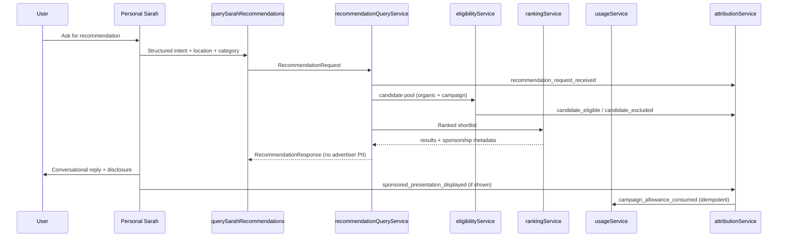

# REC-01b — Sarah Recommendations — Technical Architecture & API Contract

| Field | Value |
|-------|--------|
| **Programme** | Sarah Recommendations (RS09) |
| **Parent** | [REC-01 Master Spec](./REC-01_SARAH_RECOMMENDATIONS_MASTER_SPEC.md) |
| **Gate** | **Gate 2 — Architecture approval** (proposed; implementation still blocked until Gate 2 closed) |
| **Version** | 1.0-draft |
| **Date** | 2026-11-19 |

**Prerequisites:** [Gate 1 approved](./REC-01_GATE_01_APPROVAL.md) · [Repository audit](./REC-01_REPOSITORY_READINESS_AUDIT.md)

---

## 1. Purpose

Define service boundaries, persistence, API contracts, Sarah integration, idempotency, and tenant isolation for RS09 so REC-02…REC-09 can be implemented without revisiting core architecture.

**Out of scope for REC-01b:** Paystack/Stripe checkout UI, portal module UI, ranking ML — REC-04…REC-09.

---

## 2. Service boundaries

| Module | Path (proposed) | Responsibility |
|--------|-----------------|----------------|
| `recommendationOfferingService` | `services/recommendations/offeringService.js` | CRUD offerings; link to `companyId`; verification state |
| `recommendationOfferingVerificationService` | `services/recommendations/offeringVerificationService.js` | Offering cases (extends SNET-04 patterns) |
| `recommendationCampaignService` | `services/recommendations/campaignService.js` | Campaign lifecycle, targeting, status |
| `recommendationEligibilityService` | `services/recommendations/eligibilityService.js` | Mandatory gate chain (§8.1) |
| `recommendationRankingService` | `services/recommendations/rankingService.js` | Relevance-first sort; sponsored tie-break only among eligible |
| `recommendationUsageService` | `services/recommendations/usageService.js` | Allowance debit, exhaustion, period reset |
| `recommendationAttributionService` | `services/recommendations/attributionService.js` | Durable events + idempotency |
| `recommendationQueryService` | `services/recommendations/queryService.js` | Orchestrates eligibility → rank → response DTO |
| `recommendationAnalyticsService` | `services/recommendations/analyticsService.js` | Portal + MC rollups (read models) |
| `recommendationBillingService` | `services/recommendations/billingService.js` | RMS SKUs, activation hooks (REC-09) |
| `recommendationRoutes` | `services/api/recommendationRoutes.js` | HTTP surface |
| `personalSarahRecommendationTool` | `services/sarah/personal/personalSarahRecommendationTools.js` | Tool: `querySarahRecommendations` |
| `companySarahRecommendationTool` | future | Company surface (REC-06 phase 2) |

**Reuse (do not duplicate):**

- Org verification: `services/network/verificationService.js`
- Directory/geo: `businessDirectoryService.js`, `networkTaxonomy.js`, Discover geo helpers
- Revenue catalogue: `catalogueService.js` (RS09 SKUs added in REC-09)
- Org identity: `networkIdentityService.js`
- Admin audit: `networkAdminAudit.js`, `platformGovernance`

---

## 3. Request flow (runtime)



Sarah **must** call the tool (or internal equivalent) for any sponsored placement; the model must not invent sponsored listings.

---

## 4. Data model (Firestore)

Proposed top-level collections (add to `schema.js` in REC-02, not before Gate 2 closure):

```javascript
// REC — server-write only; tenant-scoped by companyId on docs
export const RECOMMENDATION_COLLECTIONS = {
  OFFERINGS: "recOfferings",
  OFFERING_VERIFICATION_CASES: "recOfferingVerificationCases",
  CAMPAIGNS: "recCampaigns",
  CAMPAIGN_TARGETING: "recCampaignTargeting", // subdocs or embedded on campaign
  CAMPAIGN_USAGE_PERIODS: "recCampaignUsagePeriods", // monthly bucket per campaign
  RECOMMENDATION_REQUESTS: "recRecommendationRequests", // short retention; no raw chat body
  PRESENTATION_EVENTS: "recPresentationEvents", // idempotency + metering source of truth
  ATTRIBUTION_EVENTS: "recAttributionEvents", // append-only audit stream
  CAMPAIGN_BILLING: "recCampaignBilling", // links to RMS payment records
};
```

### 4.1 `recOfferings/{offeringId}`

| Field | Type | Notes |
|-------|------|-------|
| `offeringId` | string | Opaque id |
| `companyId` | string | Tenant owner |
| `displayName` | string | |
| `categoryIds` | string[] | `networkTaxonomy` ids |
| `description` | string | |
| `status` | enum | `draft`, `submitted`, `active`, `suspended`, `archived` |
| `verificationStatus` | enum | Mirrors offering case outcome |
| `verificationCaseId` | string? | |
| `pricingSummary` | string? | Display-only; no automated price claims without verified fields |
| `geo` | object? | Service areas snapshot |
| `mediaRefs` | string[] | Listing media upload ids |
| `attributes` | map | Category-specific (vehicleId, gradeRange, etc.) |
| `updatedAt` | ISO | |

### 4.2 `recCampaigns/{campaignId}`

| Field | Type | Notes |
|-------|------|-------|
| `campaignId` | string | |
| `companyId` | string | |
| `offeringIds` | string[] | Package limits enforced in service |
| `packageSkuId` | string | e.g. `rs09.rec.starter.zar.monthly` |
| `name` | string | |
| `status` | enum | REC-01 §5.3 |
| `approvalStatus` | enum | MC queue |
| `targetCategoryIds` | string[] | |
| `targetGeo` | object | country, regions, cities, radiusKm |
| `periodStart` | ISO | |
| `periodEnd` | ISO | |
| `monthlyAllowance` | number | Presentations per period |
| `paymentStatus` | enum | Links REC-09 |
| `createdAt`, `updatedAt` | ISO | |

### 4.3 `recCampaignUsagePeriods/{periodId}`

`periodId` = `{campaignId}_{billingPeriodKey}` where `billingPeriodKey` is `YYYY-MM` (provisional default; see §12 open decisions).

| Field | Type |
|-------|------|
| `usedPresentations` | number |
| `remainingPresentations` | number |
| `exhaustedAt` | ISO? |
| `lastEventAt` | ISO? |

### 4.4 `recPresentationEvents/{eventId}`

**Source of truth** for qualified sponsored presentation (REC-01 §6.4).

| Field | Type |
|-------|------|
| `idempotencyKey` | string **unique** |
| `campaignId` | string |
| `offeringId` | string |
| `companyId` | string |
| `consumerUid` | string **hashed or opaque session ref** — not exposed to advertiser reports |
| `surface` | `personal_sarah` \| `company_sarah` \| … |
| `conversationRef` | string | `personalSessionId` or `userConversationId` |
| `messageRef` | string | Assistant message id |
| `disclosureShown` | boolean **must be true** to debit |
| `recordedAt` | ISO |
| `allowanceDebited` | boolean |

**Idempotency key (normative):**

```
idempotencyKey = sha256(
  campaignId + "|" + offeringId + "|" + conversationRef + "|" + messageRef
)
```

Retries with the same key must not double-debit.

### 4.5 `recRecommendationRequests/{requestId}`

Stores structured intent only (category, geo precision, filters) — **not** full chat transcript. Retention: 90 days default (POPIA review in REC-08).

---

## 5. API contract

All routes registered in `routeRegistry.js` under domain `recommendations` or split `consumer` / `tenant` as below.

**Auth:**

- Consumer query: `requireConsumerScope()`
- Tenant campaign CRUD: `requireTenantScope()` strict
- MC approval: `requirePlatformAccess()` or verification officer role

**Errors:** JSON `{ error, code, status }` consistent with existing API patterns.

### 5.1 Sarah Integration — query (consumer)

`POST /api/recommendations/v1/query`

**Auth:** consumer

**Body**

```json
{
  "intent": {
    "categoryId": "education",
    "queryText": "primary school near Rustenburg",
    "requirements": { "gradeBand": "primary" }
  },
  "location": {
    "country": "ZA",
    "region": "North West",
    "city": "Rustenburg",
    "suburb": null,
    "coordinates": null,
    "precision": "city"
  },
  "surface": "personal_sarah",
  "conversationRef": "ps-session-uuid",
  "limit": 5
}
```

**Response** `200`

```json
{
  "requestId": "req_…",
  "organic": [
    {
      "offeringId": "…",
      "companyId": "…",
      "displayName": "…",
      "reason": "Matches primary education near Rustenburg",
      "sponsored": false,
      "discoverProfileUrl": "/discover/…"
    }
  ],
  "sponsored": [
    {
      "offeringId": "…",
      "companyId": "…",
      "displayName": "…",
      "campaignId": "…",
      "reason": "Verified school offering in target area",
      "sponsored": true,
      "disclosureLabel": "Sponsored Recommendation",
      "discoverProfileUrl": "/discover/…"
    }
  ],
  "meta": {
    "sponsoredConsidered": 12,
    "sponsoredEligible": 1,
    "rankingPolicy": "relevance_first_v1"
  }
}
```

**No fields in response:** advertiser contact PII, campaign budgets, consumer uid, raw payment data.

### 5.2 Record presentation (server-internal or explicit)

`POST /api/recommendations/v1/presentations`

Called by Personal Sarah orchestrator **after** assistant message with disclosure is persisted.

**Auth:** consumer (same uid as conversation) or internal service token in worker context

**Body**

```json
{
  "requestId": "req_…",
  "campaignId": "…",
  "offeringId": "…",
  "conversationRef": "…",
  "messageRef": "…",
  "disclosureShown": true,
  "surface": "personal_sarah"
}
```

**Response** `201` `{ "eventId", "idempotencyKey", "allowanceDebited": true, "remainingPresentations": 29 }`

`200` with `allowanceDebited: false` if duplicate idempotency key.

### 5.3 Tenant — offerings (REC-03)

| Method | Path | Description |
|--------|------|-------------|
| GET | `/api/companies/:companyId/recommendations/offerings` | List |
| POST | `/api/companies/:companyId/recommendations/offerings` | Create draft |
| PATCH | `/api/companies/:companyId/recommendations/offerings/:offeringId` | Update |
| POST | `/api/companies/:companyId/recommendations/offerings/:offeringId/submit-verification` | Queue |

### 5.4 Tenant — campaigns (REC-04)

| Method | Path | Description |
|--------|------|-------------|
| GET | `/api/companies/:companyId/recommendations/campaigns` | List |
| POST | `/api/companies/:companyId/recommendations/campaigns` | Create draft |
| PATCH | `/api/companies/:companyId/recommendations/campaigns/:campaignId` | Update / pause |
| POST | `/api/companies/:companyId/recommendations/campaigns/:campaignId/submit` | Approval queue |
| GET | `/api/companies/:companyId/recommendations/campaigns/:campaignId/usage` | Current period |

### 5.5 Platform — Mission Control (REC-02 / REC-04)

| Method | Path | Description |
|--------|------|-------------|
| GET | `/api/operations/recommendations/verification-queue` | Offering cases |
| GET | `/api/operations/recommendations/campaign-approval-queue` | Pending campaigns |
| POST | `/api/operations/recommendations/campaigns/:campaignId/approve` | Audit + reason |
| GET | `/api/operations/recommendations/presentation-audit` | Sample presentation events |

---

## 6. Personal Sarah tool (REC-06)

**Name:** `querySarahRecommendations`

**When:** User asks to recommend businesses, products, services, schools, etc.

**Flow:** Tool calls `recommendationQueryService` → model formats reply → if sponsored items included in user-visible reply, orchestrator calls `recordPresentation` per sponsored offering shown.

**Second tool (optional phase 1b):** `recordSponsoredRecommendationPresented` — wraps presentation API with idempotency.

Tool definitions live in `personalSarahRecommendationTools.js`; **not** merged into prompt as static advertiser lists.

---

## 7. Eligibility gate chain (implementation order)

All gates must pass for **sponsored** pool (organic uses verified directory + offerings without active campaign):

1. `companyId` org verification = `verified` (SNET-04)
2. Offering `verificationStatus` = `verified` and `status` = `active`
3. Campaign `status` = `active`, `approvalStatus` = `approved`
4. `remainingPresentations` > 0
5. Category match (`targetCategoryIds` ∩ request)
6. Geo match (`targetGeo` vs request location at declared precision)
7. Policy rules (category blocklist, healthcare restrictions)
8. No suspension flags on org, offering, or campaign

Failure → `candidate_excluded` event with reason code (MC-auditable).

---

## 8. Ranking policy v1 (deterministic)

**Inputs:** eligible organic set O, eligible sponsored set S.

1. Score each candidate `relevanceScore` 0–100 from request intent (keyword + category + geo distance).
2. Sort O by score desc.
3. Sort S by score desc.
4. **Merge:** Interleave only if sponsored `relevanceScore` ≥ `MIN_SPONSORED_SCORE` (default **60**) and within **top N** organic slots (default **N = limit**).
5. **Never** place sponsored above organic when organic score exceeds sponsored by **> 15** points.
6. Cap sponsored in response at **1** for pilot (configurable `REC_SPONSORED_CAP`).

Organic-only response allowed; empty allowed.

---

## 9. Security & tenant isolation

| Rule | Enforcement |
|------|-------------|
| Tenant A cannot read Tenant B campaigns | `requireTenantScope` + `companyId` match on all tenant routes |
| Advertiser reporting | Aggregates only; enquiry attribution only after user-initiated contact event |
| Consumer uid | Not in portal campaign analytics export |
| Chat content | Not stored in `recRecommendationRequests` beyond intent summary |
| Self-approval | Campaign approve + offering verify require platform role ≠ tenant admin |
| Audit | `recordNetworkAdminAction` pattern for MC decisions |

---

## 10. Revenue catalogue (REC-09 preview)

Placeholder SKU ids (inactive until REC-09):

| skuId | Allowance/mo | amountCents |
|-------|--------------|-------------|
| `rs09.rec.starter.zar.monthly` | 30 | 75000 |
| `rs09.rec.growth.zar.monthly` | 75 | 150000 |
| `rs09.rec.professional.zar.monthly` | 180 | 300000 |
| `rs09.rec.enterprise.zar.monthly` | custom | negotiable |

`revenueStreamId`: **RS09**. Activation sets campaign `paymentStatus` + creates `recCampaignUsagePeriods`.

---

## 11. Feature flags

| Flag | Default | Phase |
|------|---------|-------|
| `RECOMMENDATIONS_ENGINE_ENABLED` | `false` | REC-05+ |
| `RECOMMENDATIONS_PERSONAL_SARAH_TOOL` | `false` | REC-06 |
| `RECOMMENDATIONS_PILOT_COMPANY_IDS` | `[]` | REC-10 |
| `RECOMMENDATIONS_CHECKOUT_ENABLED` | `false` | REC-09 (PAY-02 gated) |

Pilot: only listed `companyId`s may have **active** campaigns considered until REC-11.

---

## 12. Open decisions — provisional defaults (Gate 2)

| Decision | Provisional default for build |
|----------|------------------------------|
| Allowance period reset | Calendar month UTC (`YYYY-MM`) aligned to campaign `periodStart` month |
| Mid-cycle upgrade | **Deferred** — no proration in pilot |
| Rollover | **No** |
| Qualified presentation UI | Disclosure line required in assistant message before `recordPresentation` |
| VAT display | Ex-VAT in portal; consumer-facing copy TBD legal |
| Geo radius default | Automotive 50 km; education 30 km; professional 25 km (config table) |

Spencer may override before Gate 2 sign-off.

---

## 13. Gate 2 exit checklist

| Item | Evidence |
|------|----------|
| Service boundaries agreed | This document §2 |
| Data model agreed | §4 |
| API routes listed | §5 + `routeRegistry` update in REC-05 |
| Idempotency defined | §4.4 |
| Sarah integration path | §6 |
| Tenant isolation reviewed | §9 |
| Stakeholder sign-off | Pending — reply **REC-01 Gate 2 approved** |

**REC-02 implementation authorised only after Gate 2 closed.**

---

## 14. Related documents

- [REC-01 Master Spec](./REC-01_SARAH_RECOMMENDATIONS_MASTER_SPEC.md)
- [REC-01 Gate 1](./REC-01_GATE_01_APPROVAL.md)
- [ZIRICAI_REVENUE_ARCHITECTURE.md](./ZIRICAI_REVENUE_ARCHITECTURE.md) §7 RS09
- [SARAH_APP_TRUST_AND_CONSENT.md](./SARAH_APP_TRUST_AND_CONSENT.md)
- [ZIRICAI_REVENUE_MANAGEMENT_IMPLEMENTATION_SPEC.md](./ZIRICAI_REVENUE_MANAGEMENT_IMPLEMENTATION_SPEC.md)