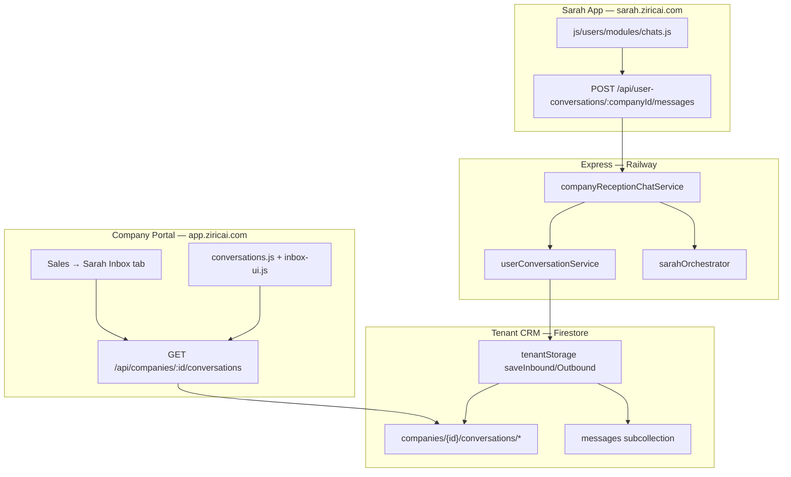
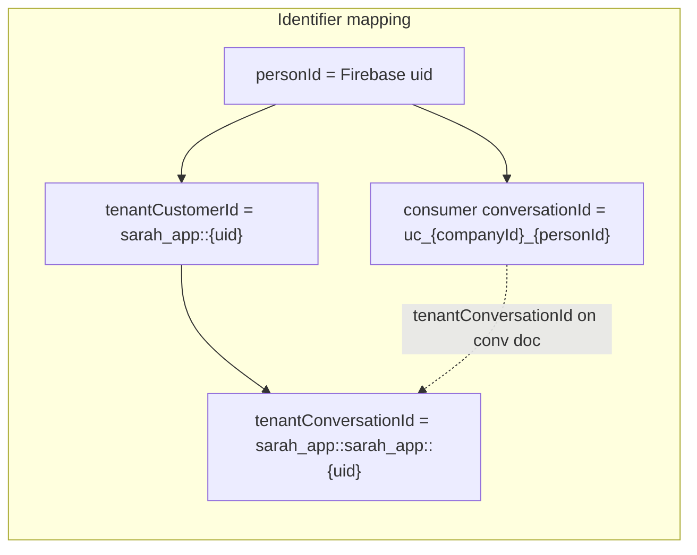
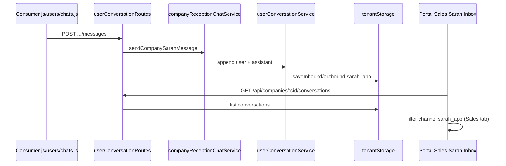
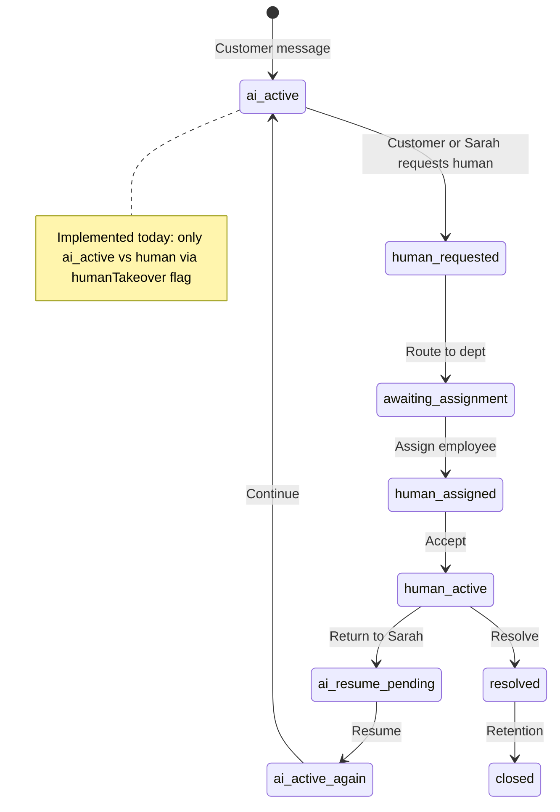

# Sarah App — CHAT-01 Specification & CH0 Architecture Audit

**Document:** `SARAH_APP_CHAT_01_SPEC_AND_AUDIT.md`  
**Programme:** **CHAT-01** — Chat as unified communication backbone  
**Phase:** **CH0** — read-only audit (docs only; no feature code)  
**Date:** 2026-11-08  
**Stakeholder spec:** CHAT-01 Product Functional Specification (approved decisions §19)  
**Related:** [SARAH_APP_MASTER_ARCHITECTURE.md](./SARAH_APP_MASTER_ARCHITECTURE.md), [SARAH_NETWORK_PROTOCOL.md](./SARAH_NETWORK_PROTOCOL.md), [COMPANY_PORTAL_SARAH_APP_INTEGRATION_AUDIT.md](./COMPANY_PORTAL_SARAH_APP_INTEGRATION_AUDIT.md), [COMPANY_PORTAL_C1_IDENTITY_EVENTS_PLAN.md](./COMPANY_PORTAL_C1_IDENTITY_EVENTS_PLAN.md), [C2_SARAH_INBOX_PROGRESS.md](./C2_SARAH_INBOX_PROGRESS.md), [SARAH_APP_CHAT_WORK_MODE_DESIGN.md](./SARAH_APP_CHAT_WORK_MODE_DESIGN.md)

---

## 1. Executive summary

CHAT-01 defines Chat as the **communication backbone** of Sarah App: people, businesses, organisations, Personal Sarah, Company Sarah, and human employees in one transparent network, with **Sarah Network** behind routing, consent, and AI-to-AI exchange.

**CH0 finding:** The repo already implements a **narrow vertical slice** of CHAT-01 — **registered consumer ↔ one tenant business** via Company Sarah (`channel: sarah_app`), dual-written into tenant CRM and (optionally) Firestore `userConversations/`. Company Portal **Sarah Inbox** (C2) can label and route `sarah_app` threads in Sales workspace. Everything else in CHAT-01 — P2P, groups, full handover state machine, Sarah-to-Sarah in-Chat UX, Discover parity, assignment/escalation — is **not implemented** or only **WhatsApp-shaped** on the portal side.

**Recommended first build slices after CH0:** **CH1** (participant/conversation/message foundation) tightening C1 contracts, then **CH4** (Discover→Chat + portal parity) or **CH6** (handover aligned to `sarah_app`).

---

## 2. Locked product decisions (CHAT-01 §19 — approved)

| # | Topic | Decision (locked) | Engineering implications |
|---|--------|-------------------|---------------------------|
| **D1** | Personal Sarah in person-to-person chats | **Private assistant by default**; user may **invite Sarah into a conversation** as an explicit participant | Need `participants[]`, consent flags, and orchestration that does **not** read private threads without grant; optional `sarahAgentId` participant type |
| **D2** | Group conversations | **Personal groups** and **authorised business/organisation groups** (consent-gated) | Separate group collections, membership RBAC, org cannot add users without invitation; optional Sarah participation per group policy |
| **D3** | Human handover triggers | **Customer**, **Company Sarah**, **authorised employee**, and **predefined escalation rules** | Event-driven handover API; rules engine per tenant; consumer-visible system messages; block competing AI/human replies |

These decisions supersede any informal “WhatsApp clone” assumptions and bind CH1–CH9 acceptance tests (see §8).

---

## 3. CHAT-01 vision (condensed from stakeholder spec)

### 3.1 Five purposes of Chat

1. Person-to-person messaging  
2. Person-to-business (Company Sarah + employees)  
3. Person-to-organisation  
4. Sarah-to-Sarah (Personal ↔ Company/Org Sarah on behalf of user)  
5. Human and AI collaboration with **Human Handover** on the same `conversationId`

### 3.2 Target conversation types (logical — CH1 data model)

| Type | Description | C1 / U5 analogue today |
|------|-------------|-------------------------|
| `person_to_person` | Two Sarah App users | **None** |
| `person_to_business` | User ↔ tenant Company Sarah | **Partial** — single thread per `(personId, companyId)` |
| `person_to_organisation` | User ↔ org tenant | **Same pipeline as business** (org = tenant) — not distinguished in code |
| `person_to_sarah` | User ↔ Personal Sarah | **Separate** — `personalSarah/{uid}/sessions` (My Sarah), not unified Chat index |
| `group_personal` | Multi-user group | **None** |
| `group_organisation` | Consent-gated org group | **None** |
| `ai_to_ai` | Network enquiry / dispatch | **Partial** — `POST /api/sarah-network/enquiries` (no Chat thread UI) |
| `human_assisted` | Same thread, human owns reply | **Partial** — tenant `humanTakeover` (WhatsApp-centric) |

### 3.3 Target handover states (CHAT-01 §7D — normative for CH6+)

| State | Meaning |
|-------|---------|
| `ai_active` | Company Sarah handling |
| `human_requested` | Customer or Sarah requested human |
| `awaiting_assignment` | Queued for employee |
| `human_assigned` | Employee assigned |
| `human_active` | Employee owns replies |
| `ai_resume_pending` | Human asked Sarah to resume |
| `ai_active_again` | Sarah resumed |
| `resolved` | Completed |
| `closed` | Retention/closed |

**Today:** Portal stores **`humanTakeover: boolean`** and **`mode: "ai" \| "human"`** on tenant conversation meta — a **subset** of the above (no assignment queue, escalation, or consumer-visible handover events).

---

## 4. Current state (codebase — CH0 inventory)

### 4.1 Sarah App consumer surfaces

| Surface | Path | Chat maturity |
|---------|------|----------------|
| **UX prototype** (rich UI, mostly mock) | `prototype/sarah-app-ux/` — `js/app.js`, `js/mock-data.js` | Chats list, filters, handover **illustrations**; company threads **not** live-bridge wired (`prototype/sarah-app-ux/js/live-bridge.mjs` — Personal Sarah only) |
| **Production consumer shell** | `js/users/modules/chats.js`, `js/users/companyChat.js` | **Live U5** — list + thread, `GET/POST /api/user-conversations*` |
| **Personal Sarah** | `js/users/modules/mySarah.js`, `services/sarah/personal/*` | **Separate** module from Chats (by design today; CHAT-01 wants unified home with filters) |

Prototype chat list aggregation: `getAllChats()` merges mock data + `rt.extraChats` in `prototype/sarah-app-ux/js/app.js` (~1962+).

### 4.2 Consumer APIs & orchestration

| Concern | Path |
|---------|------|
| Routes | `services/api/userConversationRoutes.js` |
| Consumer index + tenant mirror | `services/users/userConversationService.js` |
| Firestore mirror (C1) | `services/users/userConversationFirestoreStore.js` |
| Identity contracts | `services/users/identityContracts.js` |
| Company Sarah (reception) | `services/sarah/company/companyReceptionChatService.js` |
| Orchestrator | `services/sarah/sarahOrchestrator.js` |
| Sarah Network enquiry dispatch | `services/sarah/network/dispatchCompanyReception.js`, `services/sarah/network/sarahNetworkService.js` |
| Integration events (optional) | `services/events/publishIntegrationEvent.js`, `services/events/integrationEventContract.v1.json` |
| Schema roots | `services/database/schema.js` (`USER_CONVERSATIONS`) |

**Env (prod posture per C2 doc):** `USER_CONVERSATIONS_BACKEND=dual` — memory + Firestore mirror when admin backend available.

### 4.3 `personId` and identifiers (post-C1)

| Identifier | Rule today | Path |
|------------|------------|------|
| **personId** | **≡ Firebase Auth `uid`** for registered consumers | `services/users/identityContracts.js` — `personIdFromUserId()` |
| **conversationId (consumer)** | `uc_{companyId}_{personId}` (sanitised, max 180) | `buildConsumerConversationId()` |
| **messageId** | UUID; passed as tenant `externalId` | `userConversationService.appendUserConversationMessage()` |
| **tenantCustomerId** | `sarah_app::{sanitizedUid}` | `services/storage/tenantStorage.js` — `resolveSarahAppCustomerId()` |
| **tenantConversationId** | `conversationDocId(customerId, "sarah_app")` | `tenantStorage.js` |
| **sarahAgentId / employeeId / handoverId** | **Not in codebase** | CH1/CH6 |
| **organisationId** | Same as `companyId` (tenant) | No separate org namespace |

> **Note:** C0 integration audit (pre-C1) stated `personId` was absent; C1 introduced contracts in `identityContracts.js`. Guest/P2P `person:` prefixes remain **documented only**.

### 4.4 Company Portal — Sarah Inbox & inbox (C2 slice)

| Concern | Path |
|---------|------|
| Flat inbox module | `app/js/portal/modules/conversations.js` (mirror: `js/portal/modules/conversations.js`) |
| Shared inbox UI | `app/js/portal/modules/inbox-ui.js` — `CHANNEL_LABELS.sarah_app` → **Sarah App · Sarah Inbox** |
| Sales workspace — **Sarah Inbox** tab | `app/js/portal/salesWorkspace.js` — section `sarah_app`, `filterConversationsForSalesSection()` |
| Tenant list/reply/takeover API | `services/api/customerOpsRoutes.js` |
| Tenant conversation service | `services/tenants/conversationService.js` |
| Takeover authority | `services/conversation/takeoverSafety.js` |
| Portal API client | `app/js/portal/api.js` |

**Deployment reference:** `https://app.ziricai.com` — Company Portal; Sarah Inbox tab under Sales workspace (C2 progress: [C2_SARAH_INBOX_PROGRESS.md](./C2_SARAH_INBOX_PROGRESS.md)).

### 4.5 What works today for `sarah_app` (portal + consumer)

| Capability | Works? | Evidence |
|------------|--------|----------|
| Consumer opens thread with pilot company | ✅ | `ensureCompanyChatThread()` — `companyReceptionChatService.js` |
| Greeting + Company Sarah reply | ✅ | Orchestrator path; fallback KB digest |
| Tenant mirror `channel: sarah_app` | ✅ | `appendUserConversationMessage()` |
| Consumer list after restart (dual backend) | ⚠️ | Firestore hydrate — `tryHydrateConversationFromFirestore()` |
| Portal lists thread in API | ✅ | `listTenantConversations` |
| Portal shows **Sarah App · Sarah Inbox** label | ✅ | C2 — `inbox-ui.js`, `conversationService.js` CHANNEL_LABELS |
| Sales workspace filters `sarah_app` only | ✅ | `salesWorkspace.js`, `test/c2-sarah-inbox-channel.test.mjs` |
| Flat **Conversations** module channel filter | ⚠️ | All channels in one list; labels correct |
| Employee reply to Sarah App user | ⚠️ | `sendConversationReply()` — outbound via `integrationHub` (WhatsApp-oriented `to: phone`) |
| Takeover / release AI on `sarah_app` | ❌ / brittle | `setHumanTakeover()` **hardcodes `channel: "whatsapp"`** — `conversationService.js` ~229–232 |
| Company Sarah respects human takeover | ❌ | `companyReceptionChatService.js` — **no** `getConversationTakeoverState` check |
| Consumer sees handover state | ❌ | No API fields for CHAT-01 states |
| Integration events to portal realtime | ⚠️ | `INTEGRATION_EVENTS_SARAH_APP` optional; no portal subscriber UI |
| Sarah-to-Sarah visible in Chat | ❌ | Network returns synchronously; no `userConversations` link |

---

## 5. Gap analysis — CHAT-01 phases CH0–CH9

| Phase | Name | Current state | Gaps (primary paths to extend) |
|-------|------|---------------|--------------------------------|
| **CH0** | Read-only audit | **This document** | — |
| **CH1** | Messaging foundation | C1 contracts + single `(personId, companyId)` thread; tenant + optional Firestore | Unified **participants[]**, conversation `type`, durable SoT default `firestore`, `sarahAgentId`/`employeeId`, message roles (`human`/`system`), ordering/dedupe across restarts |
| **CH2** | Person-to-person | — | New routes/store; blocking; separate from tenant CRM unless policy links customer |
| **CH3** | Media & groups | — | Upload pipeline, group membership, D1 Sarah invite consent |
| **CH4** | Business/org chat | U5 + Discover pilot | Prototype Chats UX; `businessDirectory` Firestore; org profile **Chat** CTA; unify entry points (Status, SUB-01); consumer handover hints |
| **CH5** | Sarah-to-Sarah | U4 dispatch only | Persist network thread in Chat; show AI-to-AI transcript; consent scopes in UI |
| **CH6** | Human handover | WhatsApp takeover meta | Full state machine; `sarah_app` canonical ids in `setHumanTakeover` / `markConversationRead`; block orchestrator when `human_active`; consumer system messages; escalation rules (D3) |
| **CH7** | Portal integration | C2 label + Sales tab | Assign/transfer/escalate/accept; internal notes; human reply **without** WhatsApp send for `sarah_app`; shared history with consumer; RBAC per assignment |
| **CH8** | Advanced integrations | Work spec separate | Chat→Work link, bookings, Sarah Pay — stubs in CHAT-01 §11 |
| **CH9** | Reliability & security | Partial tests | E2E consumer↔portal consistency; retention; audit; 15 acceptance tests in spec §17 |

### 5.1 Essential acceptance tests (spec §17) — status

| # | Test | Status |
|---|------|--------|
| 1 | Two users P2P | ❌ |
| 2 | Discover → chat | ⚠️ Pilot API + production shell; prototype mock |
| 3 | Business receives in portal | ✅ Tenant list (if thread exists) |
| 4 | Company Sarah responds | ✅ |
| 5 | Personal Sarah → Company Sarah | ⚠️ API only, not Chat UI |
| 6–8 | Handover / continue / return to Sarah | ❌ |
| 9 | No competing AI/human replies | ❌ |
| 10–12 | Group privacy / tenant isolation / block | ❌ |
| 13 | Dedupe | ⚠️ Tenant `externalId`; consumer upsert partial |
| 14 | Link Work/booking/order | ❌ |
| 15 | History consistent App ↔ Portal | ⚠️ `syncMessagesFromTenant`; dual id spaces |

---

## 6. Portal connection map — `app.ziricai.com` Sarah Inbox

### 6.1 Navigation map

| User action (portal) | Module | API | Tenant record |
|---------------------|--------|-----|---------------|
| Open **Conversations** | `app/js/portal/modules/conversations.js` | `GET /api/companies/:companyId/conversations` | All channels |
| Open **Sales → Sarah Inbox** | `app/js/portal/salesWorkspace.js` | Same list + `filterConversationsForSalesSection(..., "sarah_app")` | `channel === sarah_app` |
| Open thread | `inbox-ui.js` render | `GET .../conversations/:conversationId` | `getTenantConversation()` |
| Reply | Takeover UI / compose | `POST .../reply` | `sendConversationReply()` |
| Take over / Release | `#takeoverBtn` | `POST .../takeover` | `setHumanTakeover()` |
| Mark read | — | `POST .../read` | `markConversationRead()` |

**Permission gates:** `app/js/portal/permissions.js` — `canViewInbox`, `canReply`; server: `requireAuthenticatedTenantMember()` on mutations (`customerOpsRoutes.js`).

### 6.2 Identifier map (Sarah App thread ↔ Portal row)

Portal thread detail currently resolves `conversationId` via **phone-normalisation helpers** designed for WhatsApp (`resolvePhoneFromConversationRef`, `normalizePhone`) — works when id is the **canonical sarah_app doc id** but is a **CH6/CH7 risk** for wrong channel defaults (`markConversationRead` forces `channel = "whatsapp"`).

### 6.3 End-to-end sequence (happy path — today)

---

## 7. CH4–CH7 — portal `sarah_app` assessment (detailed)

### 7.1 CH4 — Business and organisation chat

| Requirement | Today | Needed |
|-------------|-------|--------|
| Discover → Chat CTA | Production: `js/users/modules/discover.js` + `GET /api/discover/companies`; prototype mock companies | Firestore `businessDirectory/`; profile **Chat** on all entry points; single customer relationship across entry points (spec §10) |
| One thread per business | ✅ `openUserConversation(uid, companyId)` | Extend metadata for `conversation.type = person_to_business` |
| Org as tenant | ⚠️ Same `companyId` | Optional `organisationId` display label; industry presets |
| Portal sees new threads | ✅ On first message mirror | Index on `channel` + `updatedAt` (C2 ops — deployed) |

### 7.2 CH5 — Sarah-to-Sarah

| Requirement | Today | Needed |
|-------------|-------|--------|
| Personal Sarah dispatches enquiry | ✅ `sarahNetworkService` + `dispatchCompanyReception` | Create/link `userConversations` or child thread; render in Chats |
| User sees AI-to-AI transcript | ❌ | Message attribution `source: ai_to_ai`; redaction policy |
| Consent | ✅ Grant on enquiry | Surface in Chat permissions UI |

### 7.3 CH6 — Human handover

| Requirement | Today | Needed |
|-------------|-------|--------|
| Customer requests human | ❌ Consumer UI/API | Intent + `human_requested` state + system message |
| Sarah triggers handover | ❌ Reception prompt only | Tool/policy in `companyReceptionChatService` |
| Employee trigger + escalation rules | ❌ | Rules config per tenant; event bus |
| Same conversationId | ✅ Theoretically same tenant doc | Consumer-visible states; `handoverId` audit events |
| Pause Company Sarah | ❌ | Check `getConversationTakeoverState(companyId, uid, "sarah_app")` before `handleSarahChat` |
| Formal state machine | ⚠️ `humanTakeover` + `mode` | Map to §3.3 enum; assignment queue |

**Critical code gaps:**

- `services/tenants/conversationService.js` — `setHumanTakeover`, `markConversationRead`, `sendConversationReply` assume **WhatsApp channel** unless caller passes channel explicitly (often does not for Sarah Inbox).
- `services/conversation/takeoverSafety.js` — supports arbitrary `channel` but callers must pass `"sarah_app"`.
- `companyReceptionChatService.js` — always invokes orchestrator after user message.

### 7.4 CH7 — Portal integration (Sarah Inbox controls)

| CHAT-01 control | Today | Needed |
|-----------------|-------|--------|
| Take over | ✅ UI button | Fix `sarah_app` canonical id in API |
| Assign / Transfer / Escalate | ❌ | New APIs + inbox UI |
| Request Sarah / Pause Sarah | ⚠️ Release takeover ≈ Request Sarah | Explicit `ai_resume_pending` |
| Internal note | ❌ | Tenant-only message type |
| Resolve / Reopen | ⚠️ `status` field informal | First-class states |
| Employee accept conversation | ❌ | Queue + notification (`app/js/portal/modules/notifications.js`) |
| Sarah summary for employee | ❌ | Handover payload from reception context |

---

## 8. Architecture alignment — Chat home vs My Sarah vs Chats

CHAT-01 proposes a **unified Chat home** (search, filters: People / Businesses / Organisations / Sarahs / Groups). Current repo:

| Module | Spec role | Implementation |
|--------|-----------|----------------|
| **Chats** | All external + P2P + business threads | Production: business-only list (`js/users/modules/chats.js`) |
| **My Sarah** | Personal assistant (+ optional P2P invite per D1) | `personalSarahRoutes` + `mySarah.js` |
| **Work** | Linked assignments | [SARAH_APP_CHAT_WORK_MODE_DESIGN.md](./SARAH_APP_CHAT_WORK_MODE_DESIGN.md) — separate mode |

**CH1 recommendation:** Introduce a **conversation index service** that federates personal sessions, `userConversations`, future P2P/groups — without merging orchestrators.

---

## 9. Sarah Network behind Chat (protocol responsibilities)

Spec §14 responsibilities vs code:

| Responsibility | Service / doc |
|----------------|---------------|
| Identity resolution | `identityContracts.js`, `consumerAuth.js`, `tenantStorage.resolveSarahAppCustomerId` |
| Consent | `consentGrantService.js`, `sarahNetworkService.js` |
| Routing | `userConversationRoutes`, `sarahNetworkRoutes` |
| AI invoke | `companyReceptionChatService`, `dispatchCompanyReception` |
| Audit | `auditLog.js`, network store |
| Portal sync | Tenant storage + optional `publishIntegrationEvent` |

**Gap:** No single **networkConnectionId** lifecycle tying Discover, Chat, and Inbox assignment.

---

## 10. Privacy & safety (spec §16) — audit notes

| Rule | Status |
|------|--------|
| Transparency (human vs Sarah) | Portal: AI/Human badge in `inbox-ui.js`; consumer Chats: no badge |
| Sarah must not read P2P without consent | N/A until CH2; D1 requires explicit invite |
| No fake human acceptance | N/A — no accept flow |
| Tenant isolation | ✅ `requireTenantScope` / consumer scope separation |
| Blocking across Network | ❌ |

---

## 11. Dependencies on parallel programmes

| Programme | Relevance to CHAT-01 |
|-----------|---------------------|
| **C1** identity/events | Foundation for CH1 — `userConversationFirestoreStore`, backfill script `scripts/backfill-user-conversations-from-tenant.mjs` |
| **C2** Sarah Inbox | CH7 UI prefix — `C2_SARAH_INBOX_PROGRESS.md` |
| **C8** portal slice | SUB-01/BP-01 modules for org connections and subscriber chat entry |
| **U6/U7** | Discover/Status feed → Chat entry (CH4) |
| **MS-02 Work** | CH8 Chat→Work |

---

## 12. CH0 deliverables & next steps

1. **Approve this audit** as CH0 exit.  
2. Choose implementation entry: **CH1** (schema/participants) vs **CH4+CH7** (pilot E2E with SmileMore + portal handover fix).  
3. **Immediate technical debt** before handover demos: parameterise portal `setHumanTakeover` / `markConversationRead` / reply outbound for `channel: sarah_app` (`services/tenants/conversationService.js`).  
4. Add orchestrator guard in `companyReceptionChatService.js` when tenant meta is human-controlled.

**CH0 scope respected:** documentation only; no feature commits in this phase.

---

## 13. Reference index (absolute paths)

| Area | Path |
|------|------|
| CH0 audit (this file) | `C:\Users\cash\OneDrive\DOCUMENTS\PROJECTS\ziricai\docs\architecture\SARAH_APP_CHAT_01_SPEC_AND_AUDIT.md` |
| Portal integration audit | `...\docs\architecture\COMPANY_PORTAL_SARAH_APP_INTEGRATION_AUDIT.md` |
| C1 identity plan | `...\docs\architecture\COMPANY_PORTAL_C1_IDENTITY_EVENTS_PLAN.md` |
| C2 inbox progress | `...\docs\architecture\C2_SARAH_INBOX_PROGRESS.md` |
| Consumer chats UI | `...\js\users\modules\chats.js` |
| Prototype chats | `...\prototype\sarah-app-ux\js\app.js` |
| User conversations service | `...\services\users\userConversationService.js` |
| Company reception | `...\services\sarah\company\companyReceptionChatService.js` |
| Portal inbox UI | `...\app\js\portal\modules\inbox-ui.js` |
| Portal sales Sarah Inbox | `...\app\js\portal\salesWorkspace.js` |
| Tenant conversation API | `...\services\api\customerOpsRoutes.js` |
| Takeover safety | `...\services\conversation\takeoverSafety.js` |
| C2 tests | `...\test\c2-sarah-inbox-channel.test.mjs` |

---

*End of CHAT-01 CH0 specification and audit.*
