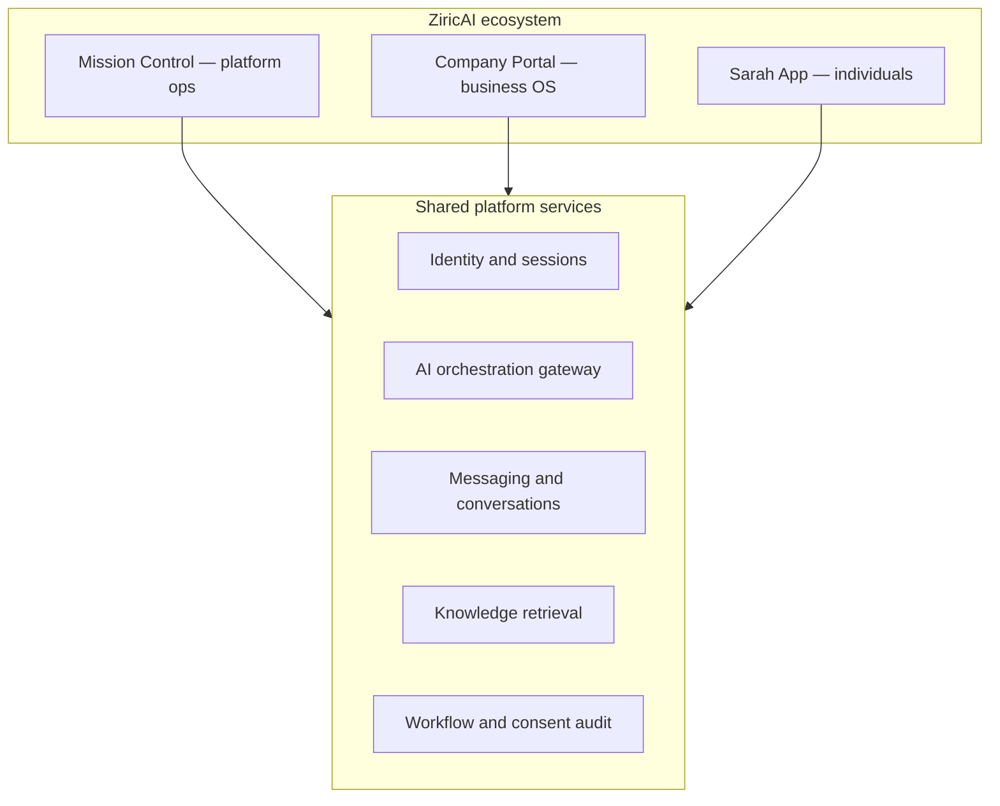

# Sarah App — Master Architecture (U0)

**Programme:** Sarah App (standalone consumer product on ZiricAI infrastructure)  
**Status:** U0 — awaiting formal sign-off ([U0_ACCEPTANCE_CHECKLIST.md](./U0_ACCEPTANCE_CHECKLIST.md))  
**Consumer domain (locked):** `https://sarah.ziricai.com` — see [SARAH_APP_DEPLOYMENT.md](./SARAH_APP_DEPLOYMENT.md)  
**U1 direction (locked):** Web PWA first, mobile-ready for native apps later  

**Decisions (locked):**

| Decision | Choice |
|----------|--------|
| Product identity | **Standalone Sarah App** — consumer brand, domain, and experience (ZiricAI = infrastructure) |
| User accounts | **Shared Firebase identity** — one UID across Mission Control, Company Portal, and Sarah App |
| Authorization | **Separate roles and data boundaries** per portal; consumer access never implies tenant membership |
| Core channel | **Sarah Network** (first-party); WhatsApp and other integrations remain **optional** for businesses |

---

## Three pillars



Sarah App is **not** a fourth skin on the Company Portal. It is a separate consumer shell on **`users/`** (independent Netlify site → `sarah.ziricai.com`) with its own navigation, APIs, and authorization policy.

### Domain map

| Environment | URL |
|-------------|-----|
| Sarah App | `sarah.ziricai.com` |
| Company Portal | `app.ziricai.com` |
| Mission Control | `admin.ziricai.com` |
| Public web | `ziricai.com` / `marketing.ziricai.com` |

---

## Sarah ecosystem (two Sarah types)

| Type | Owner | Knowledge | Tools | Typical user |
|------|-------|-----------|-------|--------------|
| **Personal Sarah** | Individual (`users/{uid}`) | My Knowledge (user-owned) | Personal assistant, Sarah Network client, consent-gated disclosures | Sarah App user |
| **Company Sarah** | Business tenant | Tenant KB + policies | CRM, appointments, tenant workflows | Customer via Sarah App **or** optional WhatsApp |

Company Sarah today is implemented as **tenant-scoped portal Sarah** (`CLIENT_OPERATOR` persona) plus **AI Employees** for customer-facing replies (WhatsApp pipeline). Sarah App will add a **consumer-facing Company Sarah** surface without exposing portal operator tools.

---

## Consumer product modules (navigation)

| Module | Purpose |
|--------|---------|
| **Chats** | Per-company conversation threads with Company Sarah |
| **My Sarah** | Personal assistant + My Knowledge entry points |
| **Status** | Social timeline (companies, creators, users) — infinite scroll, engagement, RS03 Boost |
| **Discover** | Business **profile** discovery — compact cards, industry browse, RS04 sponsored slots → company profile |
| **Profile** | Account, privacy, consents, notifications, My Knowledge management |

Original three modules (Conversations, Chat, Status) map to **Chats**, **My Sarah**, and **Status**; **Discover** and **Profile** are required for onboarding and POPIA-grade control.

---

## Architectural rules

1. **One AI engine, many identities** — extend `sarahOrchestrator.js` with new personas and tool policies; do not fork separate LLM stacks.
2. **No cross-tenant personal data** — Personal knowledge and Personal Sarah sessions live **outside** `companies/{companyId}/`.
3. **Sarah Network is protocol-based** — structured request/response with server-side auth; clients cannot impersonate Company Sarah or pre-approve consent.
4. **User is final decision-maker** — recommendations autonomous; bookings, purchases, payments, and personal-data disclosure require explicit approval records ([Sarah Trust & Consent](./SARAH_APP_IDENTITY_AND_ACCESS.md)).
5. **WhatsApp Gateway programme continues** — G7–G10 remain the optional external channel; Sarah App is the scalable default customer experience.
6. **Status ≠ Discover** — Status is a **content timeline** (time spent); Discover is a **business directory** (find profiles). Company **profiles** are the bridge to Sarah Network.
7. **Follow is free** — Paid Sarah tiers and future creator subscriptions must not be required to follow a company or creator.

---

## Status & Discover (ecosystem)

Full specification: [SARAH_APP_STATUS_DISCOVER_ARCHITECTURE.md](./SARAH_APP_STATUS_DISCOVER_ARCHITECTURE.md).

| Surface | Role |
|---------|------|
| **Status** | For You / Following / Companies / Creators / Videos feeds; text, image, video posts; likes, comments, saves, shares, qualified views; creators + companies + users |
| **Discover** | Search + industry navigation; infinite scroll of compact business cards; sponsored first in slot; **View profile** → full company page |
| **Company profile** | Services, products, reviews, location, bookings; **Connect with Company Sarah** |
| **Revenue** | RS03 Boost on Status; RS04 sponsored Discover cards — via central RMS |

Platform engines (Social Content, Infinite Feed, Engagement, Follow/Notify, Business Profile, Discover, Advertising client, Analytics) are specified in the Status/Discover architecture doc and implemented in **U6–U7**.

---

## Layered architecture

```
┌─────────────────────────────────────────────────────────┐
│ Sarah App — Web / Mobile (standalone brand)              │
│  Chats · My Sarah · Status · Discover · Profile          │
└───────────────────────────┬─────────────────────────────┘
                            │ Bearer Firebase ID token
┌───────────────────────────▼─────────────────────────────┐
│ Consumer API namespace (/api/users/*, /api/personal-sarah/*, …) │
│ requireConsumerScope() — NOT requireTenantScope()        │
└───────────────────────────┬─────────────────────────────┘
                            │
┌───────────────────────────▼─────────────────────────────┐
│ Sarah Network service — routing, sessions, audit         │
└───────────────────────────┬─────────────────────────────┘
                            │
┌───────────────────────────▼─────────────────────────────┐
│ Shared: authService, sarahOrchestrator, knowledge,       │
│ conversation pipeline, workflow, auditLog                │
└─────────────────────────────────────────────────────────┘
```

---

## Read-only codebase audit (U0)

Audit date: 2026-11-04. No production changes were made for this audit.

### Q1 — Can Firebase Authentication be reused safely across three portals?

**Yes, with extensions.**

| Finding | Detail |
|---------|--------|
| Current stack | Firebase Auth + `users/{uid}` global profile + `companies/{cid}/users/{uid}` membership ([AUTH.md](./AUTH.md)) |
| API verification | `resolveAuthFromRequest` → `verifyIdToken` + profile load |
| Portal split today | `superadmin` role → Mission Control; tenant roles → Company Portal |
| Gap | No **`consumer`** or **`individual`** role flag; profiles assume `companyId` for strict tenant mode |
| Recommendation | Add `userProfiles/{uid}` (or `users/{uid}.consumer`) with `accountType: consumer \| business`; strict tenant routes reject consumer-only accounts; consumer routes reject missing consumer profile |

Shared login is safe if **route middleware** enforces portal-specific gates, not if UI alone hides links.

### Q2 — How should Personal Sarah reuse orchestration without Company Sarah permissions?

**Reuse orchestrator + session store patterns; add persona and storage boundary.**

| Existing | Path / behavior |
|----------|-----------------|
| Personas | `PUBLIC_RECEPTION`, `CLIENT_OPERATOR`, `PLATFORM_OPERATOR` ([sarahPersona.js](../../services/sarah/sarahPersona.js)) |
| Portal gate | `assertSarahChatAccess` requires tenant membership for `CLIENT_OPERATOR` ([sarahAuth.js](../../services/sarah/sarahAuth.js)) |
| Sessions | `companies/{companyId}/sarahSessions/{sessionId}` ([sarahSessionStore.js](../../services/sarah/sarahSessionStore.js)) |
| Tools | Tenant tools (CRM, finance, MC ops) registered in [toolRegistry.js](../../services/sarah/toolRegistry.js) |

**Recommendation:**

- Add `SARAH_PERSONA.PERSONAL_ASSISTANT` and `SARAH_PERSONA.COMPANY_RECEPTION` (consumer ↔ tenant).
- New routes: `POST /api/personal-sarah/chat` and `POST /api/user-conversations/:companyId/chat` — never expose raw `POST /api/sarah/chat` to consumers with portal surfaces.
- Personal sessions: `personalSarah/{uid}/sessions/{sessionId}` (see [SARAH_APP_DATA_ARCHITECTURE.md](./SARAH_APP_DATA_ARCHITECTURE.md)).
- Tool policy: `personalTools` + `sarahNetworkTools`; exclude `bookAppointment` execution without consent wrapper.

### Q3 — How does Firestore tenant structure coexist with individual data?

**Today all operational data is tenant-rooted.**

| Data | Current location |
|------|------------------|
| Business conversations | `companies/{cid}/conversations/` |
| Customer messages (WhatsApp) | Pipeline via [conversationPipeline.js](../../services/integrations/conversationPipeline.js) → tenant conversations |
| Sarah portal chat | `companies/{cid}/sarahSessions/` |
| Global identity | `users/{uid}` |

**Recommendation:** Introduce **user-rooted** collections for consumer data (profile, personal knowledge, user↔company conversation index). Duplicate **message content** for consumer Chats UI can either:

- **Model A (preferred):** `userConversations/{conversationId}` with participant refs + mirrored messages subcollection; tenant copy remains SoT for business CRM; sync via Sarah Network events, or
- **Model B:** Single conversation doc with dual indexes (heavier rules).

Do **not** store personal knowledge under any `companies/{cid}/` path.

Firestore rules today ([firestore.rules](../../firestore.rules)) only allow tenant members on company subcollections — consumer collections need a **new rules block** before client-side reads.

### Q4 — What existing services can support Sarah Network?

| Capability | Reuse | Notes |
|------------|-------|-------|
| AI reply generation | `handleSarahChat` / orchestrator | Invoke with `COMPANY_RECEPTION` + tenant context |
| Tenant knowledge RAG | `searchCompanyKnowledge` tool | Company Sarah only |
| Conversation persistence | `conversationService` + `tenants/conversationService` | Extend with `channel: sarah_app` and external user id |
| Message queue | `messageWorker` | Optional async Sarah-to-Sarah turns |
| Audit | `auditLog` | Extend for consent and network requests |
| Discovery | Partial — company records in Firestore, no public directory API yet | New `businessDirectory` + verification flags |
| AI Employees | [aiCoreBridge](../../services/ai-core/) | Customer-facing tone for Company Sarah in app |

**Greenfield:** Sarah Network request store, consent grants, consumer notification scheduler.

### Q5 — How to connect Sarah App without disrupting MC / Company Portal?

| Risk | Mitigation |
|------|------------|
| Accidental tenant API exposure | New route registry domain `consumer`; code review gate |
| Auth confusion | Separate app shell; consumer signup flow creates consumer profile, not auto-company |
| Deploy collision | Add `users/` site to `prepare-sites.js` in U1; own Netlify site + domain |
| WhatsApp regression | No changes to gateway services for U0–U5 |
| SmileMore pilot | Use existing demo tenant; Company Sarah via network, not WhatsApp |

---

## Relationship to WhatsApp Gateway (G7–G11)

| Programme | Relationship |
|-----------|--------------|
| G7 Mission Control | Unchanged; may later show Sarah App channel metrics |
| G8–G10 managed WhatsApp | Optional business channel |
| Sarah App | Primary consumer channel; reduces scaling dependency on Meta |

---

## Pilot definition (SmileMore)

**Success criteria (U5):**

1. Consumer registers Sarah App account (shared Firebase UID + consumer profile).
2. Discover → SmileMore Dentists → start chat.
3. Company Sarah greets by user first name with tenant branding.
4. Thread appears under **Chats**.
5. User asks **My Sarah** to summarize the SmileMore thread; Personal Sarah reads authorized conversation summary only.

No WhatsApp required for pilot sign-off.

---

## Document map

| Document | Contents |
|----------|----------|
| [U0_ACCEPTANCE_CHECKLIST.md](./U0_ACCEPTANCE_CHECKLIST.md) | Sign-off gate, unresolved decisions, production safety |
| [SARAH_APP_IDENTITY_AND_ACCESS.md](./SARAH_APP_IDENTITY_AND_ACCESS.md) | Shared identity, roles, accountKinds ≠ access |
| [SARAH_APP_TRUST_AND_CONSENT.md](./SARAH_APP_TRUST_AND_CONSENT.md) | Grants, revocation, verification, audit |
| [SARAH_APP_DATA_PROTECTION.md](./SARAH_APP_DATA_PROTECTION.md) | POPIA, export, deletion, encryption |
| [SARAH_APP_SCALABILITY_AND_OPERATIONS.md](./SARAH_APP_SCALABILITY_AND_OPERATIONS.md) | Path to 100M users |
| [SARAH_APP_DEPLOYMENT.md](./SARAH_APP_DEPLOYMENT.md) | Netlify, DNS, Firebase authorized domains |
| [PERSONAL_SARAH_ARCHITECTURE.md](./PERSONAL_SARAH_ARCHITECTURE.md) | Personal assistant services and My Knowledge |
| [SARAH_NETWORK_PROTOCOL.md](./SARAH_NETWORK_PROTOCOL.md) | Sarah-to-Sarah messaging contract |
| [SARAH_APP_DATA_ARCHITECTURE.md](./SARAH_APP_DATA_ARCHITECTURE.md) | Firestore layout and ownership |
| [SARAH_APP_DEVELOPMENT_ROADMAP.md](./SARAH_APP_DEVELOPMENT_ROADMAP.md) | Phases U0–U9 and exit criteria |
| [SARAH_APP_STATUS_DISCOVER_ARCHITECTURE.md](./SARAH_APP_STATUS_DISCOVER_ARCHITECTURE.md) | Timeline, Discover, profiles, creators, RS03/RS04 UX |

---

## U0 exit criteria

- [x] Product decisions recorded (standalone Sarah App + shared identity)
- [x] Read-only audit complete (this document)
- [x] Companion architecture specs drafted
- [x] Five strengthened areas (scale, trust, identity, data protection, deployment)
- [x] `sarah.ziricai.com` deployment **configuration prepared** (not live)
- [ ] Stakeholder sign-off on [U0_ACCEPTANCE_CHECKLIST.md](./U0_ACCEPTANCE_CHECKLIST.md)
- [ ] Trademark / future TLD (`sarah.ai`) — optional pre-launch
- [ ] Legal POPIA review on [SARAH_APP_DATA_PROTECTION.md](./SARAH_APP_DATA_PROTECTION.md)

**Next engineering gate (after U0 approval only):** U1 — PWA shell, consumer registration, `requireConsumerScope()` — no Sarah Network, no consumer Firestore in prod without rules.
