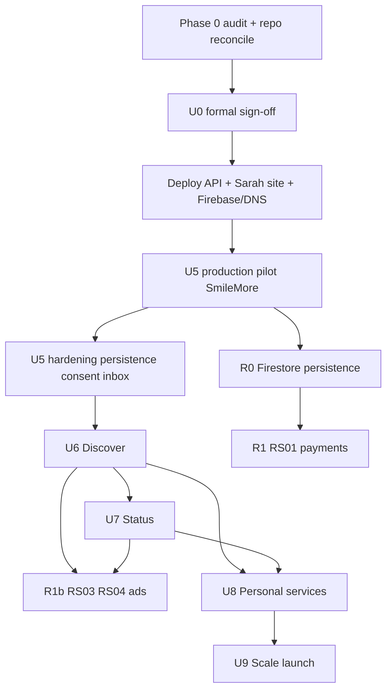

# Sarah App & ZiricAI Platform — Phase 0 Programme Readiness Audit

**Audit type:** Read-only (no code, config, deploy, or data mutations)  
**Audit date:** 2026-11-04  
**Repository:** `ziricai` (local workspace)  
**Git baseline:** branch `main`, commit `7b9ddb6cc9cf397c93f57dd044f85d3210f35c0d`  
**Remote sync:** `main...origin/main` — **ahead 1, behind 7** (diverged)

---

## Executive summary

The programme has **substantial Sarah App implementation (U1–U5) and Revenue R0 in the local working tree**, but **most of that work is not committed to `main` and is not proven on production API**. Documentation for U0, U6/U7, and Revenue is **strong**; **formal U0 stakeholder sign-off must not be assumed** despite an older checklist marking “Approved 2026-11-04.”

**Before new feature work:** commit/reconcile repository state, redeploy API with U4–U5 + R0, complete Firebase/Netlify/DNS checklist, run SmileMore pilot acceptance in production, and **close U0 with evidence** (see [SARAH_APP_U0_ACCEPTANCE_CHECKLIST.md](./SARAH_APP_U0_ACCEPTANCE_CHECKLIST.md)).

| Area | Status |
|------|--------|
| U1–U3 | Implemented locally; **deployed to Railway/Netlify per Nov audit** (U3 deploy record) |
| U4–U5, R0 | Implemented locally; **likely not on production API** until redeploy |
| U0 sign-off | **Outstanding** (evidence-based gate) |
| U6 / U7 | **Architecture ready**; not implemented |
| Revenue activation | **Off** (R0 shadow only) |

---

## 1. Mandatory restrictions (audit compliance)

This audit did **not** modify application code, Firestore, rules, Firebase Auth, Netlify, Railway, DNS, WhatsApp/Meta, tenant mappings, credentials, or `commercialActivation` flags. No mutating production API calls were made.

---

## 2. Repository and branch baseline

### 2.1 Git state (evidence: `git status`, `git log`)

| Item | Finding |
|------|---------|
| Branch | `main` @ `7b9ddb6` (latest commit message: WhatsApp Gateway G5) |
| vs `origin/main` | Ahead **1**, behind **7** — reconciliation required before release |
| Working tree | **Very large** — 100+ modified tracked files; **Sarah U1–U5 + R0 mostly untracked** (`??`) |

**Sarah-related untracked (representative):**

- `services/api/consumerRoutes.js`, `personalSarahRoutes.js`, `personalKnowledgeRoutes.js`, `sarahNetworkRoutes.js`, `userConversationRoutes.js`, `revenueRoutes.js`, `platformRevenueRoutes.js`
- `services/auth/consumerAuth.js`, `services/users/*`, `services/sarah/personal/*`, `services/sarah/network/*`, `services/sarah/company/*`, `services/revenue/*`
- `js/users/*`, `users/`, `css/sarah-app.css`, `test/consumer-profile-u1.test.mjs` … `user-conversations-u5.test.mjs`, `revenue-r0.test.mjs`
- Architecture docs under `docs/architecture/SARAH_*`, `ZIRICAI_REVENUE_*`

**Risk:** Production deploys from **remote `main` may omit U4–U5 entirely**. Local “complete programme” ≠ shipped programme until commit + push + deploy.

### 2.2 Programme documentation vs implementation

| Document set | Match to code |
|--------------|----------------|
| U0 architecture (6+ docs) | Aligned with **local** implementation intent |
| [U0_ACCEPTANCE_CHECKLIST.md](./U0_ACCEPTANCE_CHECKLIST.md) | **Stale:** claims no rules change / no deploy; repo has `firestore.rules` consumer blocks (modified, deploy status unknown) |
| U6/U7 [SARAH_APP_STATUS_DISCOVER_ARCHITECTURE.md](./SARAH_APP_STATUS_DISCOVER_ARCHITECTURE.md) | Spec only — no `statusPosts` / full Discover engine in code |
| Revenue trio | Aligned with R0 code in workspace |

### 2.3 Branch / production alignment risks

- Multiple local worktrees (`.p0-*`, `.g2-1-wt`, etc.) — **do not merge/reset without programme owner approval**
- Prior todo: prod snapshot vs main reconciliation — **still relevant** for Central Motors / Client Zero safety

---

## 3. Sarah App U1–U5 verification

Legend: **Impl** = in local repo · **Test** = automated test · **Dep** = deployment evidence · **Prod** = production-verified behaviour

### U1 — App foundation

| Aspect | Detail |
|--------|--------|
| Intended | Consumer bootstrap, profile, PWA shell, `requireConsumerScope` |
| Impl | `services/api/consumerRoutes.js`, `services/users/consumerProfileService.js`, `services/auth/consumerAuth.js`, `js/users/*`, `users/netlify.toml` |
| Routes | `POST /api/users/bootstrap`, `GET/PATCH /api/users/profile` ([routeRegistry.js](../../services/api/routeRegistry.js)) |
| Test | `test/consumer-profile-u1.test.mjs` — **PASS** (audit run) |
| Dep | [sarah-app-u1-foundation-2026-11-04.json](../audit/sarah-app-u1-foundation-2026-11-04.json) |
| Limitations | Consumer paths in `firestore.rules` (local); **rules deploy to Firebase unconfirmed** |
| Complete? | **Yes locally**; **production parity unverified** |

### U2 — Personal Sarah

| Aspect | Detail |
|--------|--------|
| Impl | `services/sarah/personal/*`, `POST /api/personal-sarah/chat` |
| Test | `test/personal-sarah-u2.test.mjs` — **PASS** |
| Dep | Included in U3 Railway deploy record |
| Limitations | Demo mode without `OPENAI_API_KEY`; no production usage metering |
| Complete? | **MVP yes** |

### U3 — My Knowledge

| Aspect | Detail |
|--------|--------|
| Impl | `personalKnowledgeService.js`, `/api/personal-knowledge/sections` |
| Test | `test/personal-knowledge-u3.test.mjs` — **PASS** |
| Dep | U3 deploy record |
| Limitations | Document upload/storage lifecycle partial vs data-protection doc |
| Complete? | **MVP yes** |

### U4 — Sarah Network

| Aspect | Detail |
|--------|--------|
| Impl | `services/sarah/network/*`, `consentGrantService.js`, `businessDirectoryService.js`, `/api/sarah-network/*` |
| Test | `test/sarah-network-u4.test.mjs` — **PASS** |
| Dep | **Not listed** in U3 deploy audit — assume **not production** |
| Limitations | In-memory grants/requests; sync dispatch only; no worker queue |
| Complete? | **Core API yes**; not production-hardened |

### U5 — Company conversations (pilot)

| Aspect | Detail |
|--------|--------|
| Impl | `userConversationService.js`, `companyReceptionChatService.js`, `/api/user-conversations/*`, `/api/discover/companies`, Chats/Discover UI |
| Test | `test/user-conversations-u5.test.mjs` — **PASS** |
| Tenant dual-write | `tenantStorage.js` — `sarah_app` channel, `resolveSarahAppCustomerId` |
| Dep | **Not in U3 deploy record** |
| Limitations | User conversation index **in-memory** (lost on restart); consent **in-memory**; no grant UI; portal inbox filter for `sarah_app` not verified; Discover is **pilot list only** |
| SmileMore | `SMILEMORE_DEMO_COMPANY_ID` + pilot directory seed |
| Complete? | **Pilot locally yes**; **not production-ready without persistence + deploy** |

### Cross-cutting security notes

| Control | Status |
|---------|--------|
| `requireConsumerScope` | Requires `userProfiles/{uid}` — [consumerAuth.js](../../services/auth/consumerAuth.js) |
| Tenant isolation | Consumer routes do not use tenant membership for auth; companyId validated via discoverability + conversation ownership |
| `/api/sarah/chat` | Not mounted for consumer namespace (per architecture) |
| Conversation access | Server-side only; no client Firestore for `userConversations` yet |
| Rate limits | Sarah Network + chat use `authRateLimit` on some routes |

---

## 4. U0 architecture acceptance (summary)

Full evidence matrix: [SARAH_APP_U0_ACCEPTANCE_CHECKLIST.md](./SARAH_APP_U0_ACCEPTANCE_CHECKLIST.md).

**Do not treat U0 as closed** until stakeholder sign-off on outstanding items (POPIA legal review, production boundaries, persistence strategy, deploy evidence).

Conflict: [U0_ACCEPTANCE_CHECKLIST.md](./U0_ACCEPTANCE_CHECKLIST.md) states “U0 sign-off: Approved 2026-11-04” and “No Firestore rules changed” — **contradicted** by current `firestore.rules` consumer matches (lines 62–87) and deployment history in audit JSONs.

---

## 5. Deployment and SmileMore pilot (summary)

Detail: [SARAH_APP_PRODUCTION_DEPLOYMENT_READINESS.md](./SARAH_APP_PRODUCTION_DEPLOYMENT_READINESS.md)  
Pilot script: [SARAH_APP_SMILEMORE_PILOT_ACCEPTANCE.md](./SARAH_APP_SMILEMORE_PILOT_ACCEPTANCE.md)

**Evidence of partial deploy (2026-11-04):**

- Railway: deployments including U1–U3 APIs ([u3 deploy audit](../audit/sarah-app-u3-deploy-2026-11-04.json))
- Netlify Sarah: `ziricai-sarah.netlify.app` (site id `6200fa94-…`)
- Custom domain `sarah.ziricai.com`: **pending**
- Firebase authorized domains / rules deploy: **operator pending** per audit JSON

---

## 6. U6 / U7 readiness (summary)

[SARAH_APP_U6_U7_IMPLEMENTATION_READINESS.md](./SARAH_APP_U6_U7_IMPLEMENTATION_READINESS.md)

Specs reflect agreed direction (timeline vs profile-centric Discover). **Implementable after Gate 2–3** with known decisions (search backend, media storage, moderation ops).

---

## 7. Revenue Management (summary)

[ZIRICAI_REVENUE_IMPLEMENTATION_READINESS.md](./ZIRICAI_REVENUE_IMPLEMENTATION_READINESS.md)

R0 present locally; **commercialActivation all false**; ledger in-memory; no payment webhooks.

---

## 8. Programme dependency map

**Parallel (after U0):** Revenue **architecture** documentation and R0 persistence can proceed alongside U5 hardening; **commercial activation** only after product + payment gates.

---

## 9. Recommended execution order (matches stakeholder programme)

1. **Phase 0 close** — reconcile git; commit Sarah programme; align with `origin/main` safely  
2. **Gate 2** — U0 formal sign-off with updated checklist  
3. **Phase 1** — deploy + SmileMore pilot (Gate 3)  
4. **U5 hardening** — Firestore persistence, consent UX, portal inbox, rules review  
5. **U6 → U7** (Gates 4–5)  
6. **Revenue** — R0 prod persistence, then R1+ when approved (Gate 6)

---

## 10. Stakeholder decisions required

| # | Decision |
|---|----------|
| D-S0-1 | Approve **programme baseline** (this audit + six deliverables) |
| D-S0-2 | **Git strategy:** commit untracked Sarah work; how to reconcile ahead/behind `origin/main` without harming production tenants |
| D-S0-3 | **Formal U0 sign-off** — accept/reject; resolve checklist conflict with older “Approved” doc |
| D-S0-4 | Authorize **Phase 1 deploy** (Railway + Netlify + Firebase domains + rules) |
| D-S0-5 | Accept **U5 pilot scope** (in-memory conversations acceptable for pilot Y/N) |
| D-S0-6 | POPIA / legal review scheduling for consumer data |
| D-S0-7 | U6 search backend (Firestore vs external index) — can defer but before U6 build |
| D-S0-8 | Gate 6 timing for RS01 vs RS02 activation |

---

## 11. Related deliverables (Phase 0)

1. [SARAH_APP_U0_ACCEPTANCE_CHECKLIST.md](./SARAH_APP_U0_ACCEPTANCE_CHECKLIST.md)  
2. [SARAH_APP_PRODUCTION_DEPLOYMENT_READINESS.md](./SARAH_APP_PRODUCTION_DEPLOYMENT_READINESS.md)  
3. [SARAH_APP_SMILEMORE_PILOT_ACCEPTANCE.md](./SARAH_APP_SMILEMORE_PILOT_ACCEPTANCE.md)  
4. [SARAH_APP_U6_U7_IMPLEMENTATION_READINESS.md](./SARAH_APP_U6_U7_IMPLEMENTATION_READINESS.md)  
5. [ZIRICAI_REVENUE_IMPLEMENTATION_READINESS.md](./ZIRICAI_REVENUE_IMPLEMENTATION_READINESS.md)

**Stop:** Await explicit approval before implementation phases.
