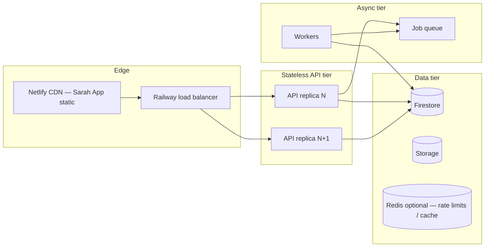

# Sarah App — Scalability and Operations

**Scope:** Design for evolution toward **~100M users** without building full hyperscale infrastructure in U1–U3.  
**Principle:** Stateless edges, bounded state in data stores, async work on queues, explicit cost and abuse controls.

---

## Target scaling dimensions

| Dimension | U1–U3 (pilot) | Growth (U4–U8) | At scale (100M ambition) |
|-----------|---------------|----------------|---------------------------|
| Registered users | 10³–10⁴ | 10⁵–10⁶ | 10⁷–10⁸+ |
| DAU | 10²–10³ | 10⁴–10⁵ | 10⁶+ |
| Messages / day | 10³ | 10⁶ | 10⁸+ |
| Discover reads | Mostly cached | CDN + read replicas | Global edge cache |
| Status feed reads | N/A until U7 | Cursor pagination + lazy media | Feed service shard by uid prefix; precompute hot For You |
| My Knowledge storage | GB | TB | PB (Storage + lifecycle) |

Architecture must **not** assume a single Firestore document, one global collection scan, or one long-lived AI session per user.

---

## Stateless API architecture

**Rule:** Railway / Express API processes hold **no in-memory user session state** required for correctness.

| Concern | Pattern |
|---------|---------|
| Authentication | Firebase ID token verified per request (`verifyIdToken`) |
| Authorization | Load grants from Firestore / cache; no sticky sessions |
| Sarah chat turns | Read session id from client; load history from `personalSarah/{uid}/sessions` |
| Idempotency | `Idempotency-Key` on writes (book, submit, network request) |

Horizontal scaling: **multiple Railway replicas** behind load balancer; any replica can serve any request.

**Avoid:** Storing conversation history only in process memory (except test `STORAGE_BACKEND=memory`).

---

## Horizontal scaling

**Phase-in:** Single Railway service + existing [jobQueue.js](../../services/queue/jobQueue.js) today; split **consumer API worker** when Sarah Network volume warrants dedicated processes.

---

## Queue-based background processing

Use queues for anything **>2s**, **retriable**, or **fan-out**:

| Job type | Examples |
|----------|----------|
| `sarah_network_dispatch` | Personal → Company Sarah enquiry |
| `notification_deliver` | Push / email reminder |
| `directory_sync` | Tenant public profile → `businessDirectory` |
| `status_fanout` | New company post → follower feeds (U7) |
| `embedding_index` | My Knowledge document → vector index |
| `export_user_data` | POPIA export pack |
| `delete_user_account` | Async erasure pipeline |

Reuse queue patterns from WhatsApp [messageWorker.js](../../services/queue/workers/messageWorker.js).

**Sarah-to-Sarah at scale:** Never synchronous multi-tenant fan-out in one HTTP request; enqueue one job per company enquiry.

---

## Session persistence

| Session type | Store | TTL / size cap |
|--------------|-------|----------------|
| Personal Sarah chat | `personalSarah/{uid}/sessions/{id}` | 90d inactive; max 100 messages (mirror portal Sarah) |
| Company chat (consumer) | `userConversations/{id}` + tenant mirror | Paginated; archive policy |
| Firebase Auth session | Firebase client SDK | Standard refresh |
| Sarah Network request | `sarahNetwork/requests/{id}` | Retention per policy |

**Not** stored in API memory across requests.

---

## Database indexing and partitioning

### Firestore (initial SoT)

| Pattern | Implementation |
|---------|------------------|
| User-scoped writes | Path prefix `personalKnowledge/{uid}/…` — natural partition by uid |
| Hot collections | Avoid unbounded global `messages` collection |
| Conversation list | Composite: `userId` + `lastMessageAt` |
| Discover | `businessDirectory` — denormalized; **read-heavy**, rarely write |
| Sharding prelude | If single collection exceeds limits, shard by `uid[0:2]` prefix in collection id (future) |

### Beyond Firestore (future, not U1)

Document decision triggers:

- Firestore cost / query limits at ~10M+ DAU
- Full-text search at Discover scale → **Algolia / Typesense / Elastic** (read replica)
- Message archive → **GCS / BigQuery** cold store

**Do not implement alternate DB in U0–U1** — design APIs so storage adapter can swap ([storage adapter pattern](../../services/database/) already exists).

---

## AI inference cost management

| Control | Mechanism |
|---------|-----------|
| Model tiering | Small model for routing/classification; large model for complex Personal Sarah turns |
| Context budgets | Cap tokens from My Knowledge retrieval per turn |
| Caching | Cache Company Sarah FAQ answers per tenant (TTL) |
| Per-user quotas | Free tier daily message cap; soft + hard limits |
| Per-tenant quotas | Company Sarah replies to consumers billed to tenant plan |
| Batch Sarah Network | Off-peak processing for non-urgent compare jobs |
| Observability | Log `promptTokens`, `completionTokens`, `companyId`, `userId` hash per request |

**Product:** Sarah explains when limits apply; never silent failure.

---

## Rate limiting and abuse prevention

| Layer | Control |
|-------|---------|
| Edge | Netlify / CDN — static only |
| API gateway | Per-IP and per-uid rate limits (extend [authRateLimiter.js](../../services/auth/authRateLimiter.js)) |
| Consumer routes | Stricter limits on signup, login, chat, network enqueue |
| Sarah Network | Per-user max concurrent enquiries; per-tenant max inbound from network |
| Discover scrape | Rate limit search; CAPTCHA on anomaly |
| Content | Report company / block user; MC moderation queue |
| Cost abuse | Alert on uid with >N tokens/hour |

**Fraudulent companies:** Verification gate before `businessDirectory.verified === true`.

---

## Independent observability (Sarah App)

| Signal | Source |
|--------|--------|
| Uptime | Netlify + Railway health |
| API latency | Railway metrics; route tags `domain=consumer` |
| Error rate | Sentry / logs filtered by `sarah_app` |
| AI cost | Daily roll-up job |
| Queue depth | Worker metrics |

Sarah App deploy must **not** require redeploying `app/` or `admin/` to release consumer UI fixes.

---

## What we defer (explicitly)

- Multi-region active-active
- Dedicated vector DB cluster
- Kafka / PubSub at launch (use existing job queue first)
- Auto-scaling ML inference GPU pool

---

## Related documents

- [SARAH_APP_DEPLOYMENT.md](./SARAH_APP_DEPLOYMENT.md) — independent Netlify site
- [SARAH_APP_TRUST_AND_CONSENT.md](./SARAH_APP_TRUST_AND_CONSENT.md)
- [SARAH_APP_DATA_ARCHITECTURE.md](./SARAH_APP_DATA_ARCHITECTURE.md)
