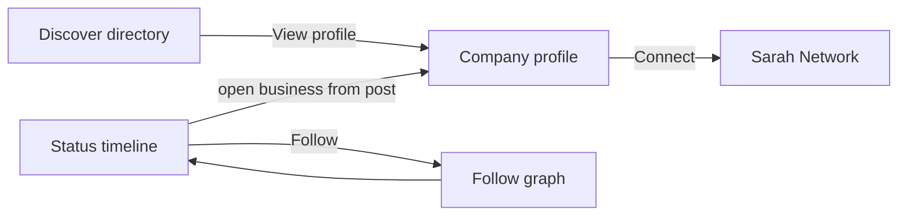

# Sarah App — Status, Discover, Business Profiles & Creator Platform

**Document:** `SARAH_APP_STATUS_DISCOVER_ARCHITECTURE.md`  
**Version:** 1.0  
**Status:** Architecture approved for U6/U7 design — **implementation after U0 sign-off; no premature prod collections**  
**Commercial linkage:** RS03 (Status Boost), RS04 (Discover sponsored) via [ZIRICAI Revenue Management](./ZIRICAI_REVENUE_MANAGEMENT_IMPLEMENTATION_SPEC.md)

---

## 1. Product split

Sarah App needs **two distinct reasons to return**:

| Product | User job | Primary UX |
|---------|----------|------------|
| **Status** | Spend time, follow interests, watch content | Facebook-style **timeline** — infinite scroll |
| **Discover** | Find businesses and start relationships | **Profile-centric directory** — compact cards, deep company profile |

They connect through **follows**, **saved posts**, **profile deep-links**, and **Sarah Network** (Connect with Company Sarah).

---

## 2. Status — social content timeline

### 2.1 Design reference

Timeline familiar to users (Facebook-style), with Sarah App visual identity. **Not** a company-only ad feed.

### 2.2 Publisher account categories

| Category | `publisherType` | Publish via |
|----------|-----------------|-------------|
| Companies | `company` | Company Portal (+ API) |
| Influencers | `influencer` | Sarah App creator onboarding (U7+) |
| Content creators | `creator` | Sarah App |
| Ordinary users | `user` | Sarah App (policy-gated) |

Creators and users supply **organic audience**; companies participate where people already spend time.

### 2.3 Post content types

| Type | Payload |
|------|---------|
| `text` | Body, optional hashtags |
| `image` | Single or gallery |
| `video` | Short or long; streaming-friendly |
| `mixed` | Text + media |

Media stored in Firebase Storage; posts hold metadata + CDN URLs.

### 2.4 Feed card (client)

Each card shows:

- Avatar, display name, verified badge (if applicable)
- Follow control (if not following)
- Timestamp
- Text / media
- **Like** + count · **Comment** + count · **Save** + count · **Share** + count
- **View** count (qualified — see §2.7)
- **Sponsored** label when RS03 campaign applies
- Overflow menu: report, hide, block

### 2.5 Feed tabs (default: **For You**)

| Tab | Content |
|-----|---------|
| For You | Blended ranking (§2.6) |
| Following | Accounts the user follows |
| Companies | Company publishers only |
| Creators | Influencers + creators |
| Videos | Video-first ranking |

### 2.6 Feed ranking (not pure chronological)

Signals (weighted, tunable):

1. Follow graph  
2. Interest / industry affinity  
3. Engagement quality  
4. Freshness  
5. **Sponsored slots** — labelled, capped frequency; **payment does not override safety or organic For You entirely**

**Technical:** Cursor-based pagination (`feedCursor`), lazy media, server-side feed composition service (**Infinite Feed Engine**).

### 2.7 Engagement metrics

| Metric | Rule (initial) |
|--------|----------------|
| Views | Text/image: ≥1s visible in viewport; video: ≥3s playback or 25% watched |
| Likes | Idempotent per user per post |
| Comments | Thread count |
| Saves | Bookmark list per user |
| Shares | Outbound share events |

**Engagement Engine** owns counters; increments via authenticated API or server-side batch (anti-inflation).

### 2.8 Follow vs subscribe vs notifications

| Action | Meaning |
|--------|---------|
| **Follow** | Free; posts eligible for **Following** tab |
| **Notifications** | Optional per-account preference |
| **Paid subscription** | Future creator/company product — **not** required to follow |

Starting a Company Sarah chat **does not** auto-follow (user setting).

### 2.9 Trust & moderation

Reporting, spam controls, impersonation handling, verified badge policy (**verification ≠ paid ad**). See [SARAH_APP_TRUST_AND_CONSENT.md](./SARAH_APP_TRUST_AND_CONSENT.md).

### 2.10 RS03 — Status Boost (delivery)

Boosted posts injected in For You / relevant tabs at controlled intervals; campaign analytics in Company Portal; spend via RMS ad wallet ([Revenue spec](./ZIRICAI_REVENUE_MANAGEMENT_IMPLEMENTATION_SPEC.md)).

---

## 3. Discover — business discovery directory

### 3.1 Purpose

Discover **profiles**, not company post timelines. Compact browsing with infinite scroll.

### 3.2 Discover home

**Header:** Search companies, services, products, location; industry browse.

**Body:** Vertical list of **business discovery cards**:

- Banner image + logo avatar  
- Name, verification badge  
- Industry · location (one line)  
- Short description (clamped)  
- Rating / reviews when available  
- **Sponsored** label when RS04 applies  
- **View Business Profile →** (primary CTA)

Cards stay **compact** (multiple per viewport).

### 3.3 Navigation filters

| Filter | Notes |
|--------|-------|
| All | Default mixed directory |
| Companies / Services / Shopping / Food / Bookings | Configurable facets |
| By industry | Driven by **Industry Preset Library** — not hardcoded UI lists |

### 3.4 RS04 — Sponsored placement

- Sponsored cards occupy **designated slots** before organic results in category/search views  
- Organic listings always remain  
- Sponsored ≠ verified  
- Relevance and location still apply — no “buy every keyword globally”

**Discover Engine** merges organic index + sponsored inventory from RMS.

---

## 4. Company profile — discovery → relationship

Dedicated **Company Profile** screen (not a duplicate directory row).

| Section | Content |
|---------|---------|
| Header | Banner, logo, name, verification |
| About | Description |
| Services | Service list / presets |
| Products | Catalogues where enabled |
| Status | Embedded strip or link to company posts on Status |
| Reviews | Ratings & feedback |
| Location | Branches, service areas |
| Contact | Phone, email, web |
| Bookings | Appointments (U8+) |

**Primary CTA:** **Connect with Company Sarah** — starts Sarah Network flow with consent; user approves disclosures and consequential actions.

Example journey: Discover dentist → profile → services → Connect → ask availability → book (with approval).

---

## 5. Creator platform (phased)

**U7 MVP:** Creator/influencer publishing on Status, public creator profile (avatar, bio, follower count, content library).

**Later:** Analytics, brand collaborations, creator monetisation, revenue share — not full creator economy in v1.

Creator profiles live under `creatorProfiles/{uid}` (see data architecture).

---

## 6. Platform engine modules

| Module | Responsibility | Primary phase |
|--------|----------------|---------------|
| **Social Content Engine** | CRUD posts, media, publisher types | U7 |
| **Infinite Feed Engine** | Ranking, cursors, sponsored insertion | U7 |
| **Engagement Engine** | Likes, comments, saves, shares, views | U7 |
| **Follow & Notification Engine** | Follow graph, notify prefs | U7 |
| **Creator Platform** | Creator profiles, tools | U7+ |
| **Business Profile Engine** | Public company profile, services, reviews | U6 |
| **Discover Engine** | Search, filters, industry browse, sponsored merge | U6 |
| **Advertising Engine** | RS03/RS04 campaigns (RMS client) | U6/U7 + R1b |
| **Sarah Network Connector** | Profile → Company Sarah | U4–U6 |
| **Analytics Engine** | Post reach, profile visits, boost ROI | U6/U7 |

Integrates with: RMS, Industry Presets, identity (`userProfiles`, verification), [SARAH_NETWORK_PROTOCOL.md](./SARAH_NETWORK_PROTOCOL.md).

---

## 7. Company analytics (portal)

Businesses see: post views/reach, engagement, profile visits from posts, followers gained, enquiries, attributed bookings (where measurable), Boost performance.

---

## 8. Development sequence

| Phase | Deliverable |
|-------|-------------|
| **U6** | Discover directory, search, industry browse, business profile, RS04 hooks (organic first), Connect with Company Sarah |
| **U7** | Status timeline, media posts, engagement, follow graph, feed tabs, RS03 hooks, creator publishing (MVP) |
| **U8+** | Bookings on profile, deep attribution |

**Gate:** [U0_ACCEPTANCE_CHECKLIST.md](./U0_ACCEPTANCE_CHECKLIST.md) — these requirements are **in scope for architecture review**, not a bypass of U0.

---

## 9. Related documents

- [SARAH_APP_MASTER_ARCHITECTURE.md](./SARAH_APP_MASTER_ARCHITECTURE.md)  
- [SARAH_APP_DATA_ARCHITECTURE.md](./SARAH_APP_DATA_ARCHITECTURE.md) — collections for posts, feed, discover  
- [SARAH_APP_DEVELOPMENT_ROADMAP.md](./SARAH_APP_DEVELOPMENT_ROADMAP.md) — U6/U7 exit criteria  
- [ZIRICAI_REVENUE_ARCHITECTURE.md](./ZIRICAI_REVENUE_ARCHITECTURE.md) — RS03/RS04  
