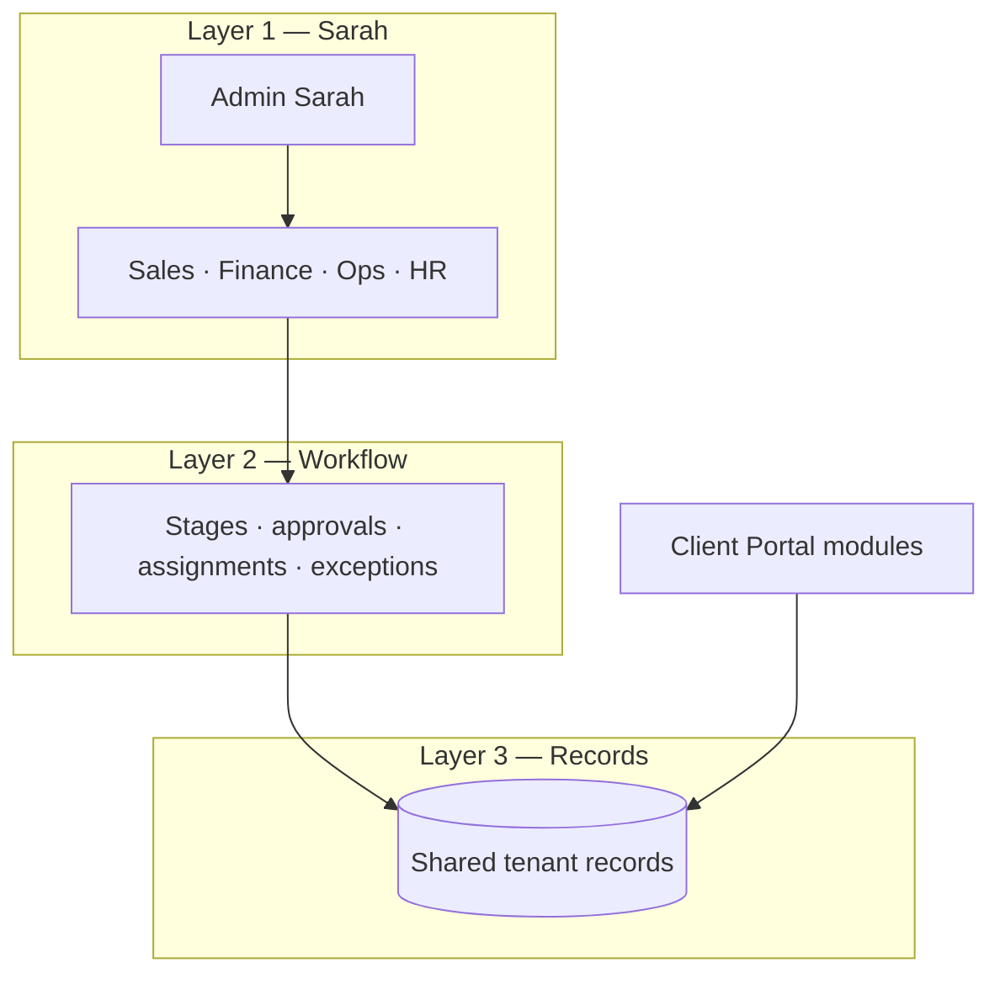

# Sarah Business Operating System (BOS) — Operating Model

**Status:** Target architecture (proposed). Not a claim that the full cycle is implemented in production.

**Related:** [SARAH.md](./SARAH.md) (orchestrator & tools), [CUSTOMER_OPS.md](./CUSTOMER_OPS.md) (CRM/inbox/appointments/events), [FINANCE_PORTAL_V1.md](./FINANCE_PORTAL_V1.md) (workspace ledger).

## Product promise

A business owner configures company, catalogue, people, prices, policies, and approval rules. ZiricAI coordinates work from **first conversation** through **payment, delivery, and satisfaction**, with the human owner informed and in control.

**Core distinction:** Sarah is not five separate chatbots. It is **one coordinated team**—Admin Sarah coordinates; specialist Sarahs own domains; **workflow + persistent records** execute reliably (conversation alone is not the system of record).

## Organisational structure

| Role | Responsibility | Must not |
|------|----------------|----------|
| **Admin Sarah** | Delegation, oversight, escalation, bringing work together | Bypass domain permissions or mutate records outside coordinator contract |
| **Sales Sarah** | Customer channels, leads, follow-ups, bookings, sales comms | Mark paid, authorise delivery, or change ledger without Finance/workflow |
| **Finance Sarah** | Quotations, invoices, **verified** payments, receivables, financial records | Release work on proof-of-payment alone; skip approval rules |
| **Operations Sarah** | Projects/jobs, tasks, milestones, delivery, QC | Start billable work before workflow prerequisites |
| **HR Sarah** | Availability, skills, assignments, workload | Hire/fire or override company approval policies |

**Shared business records (source of truth):** customers, opportunities, quotations, invoices, payment records, bookings, projects/jobs, tasks, staff assignments, delivery outcomes, audit history—all **tenant-scoped**.

## Three layers

1. **Sarah intelligence & delegation** — Understand requests, route to specialist, ask for missing data, communicate progress.
2. **Workflow & business rules** — Tasks, ownership, permissions, prerequisites, status transitions, next-step triggers; **does not rely on chat memory**.
3. **Persistent business records** — Authoritative state for portal, CRM, dashboard, analytics.

## Reference lifecycle (configurable per company)

Stages are **templates**, not one rigid sequence (deposits, credit terms, HR vs automated delivery, vertical-specific steps).

| Stage | Primary owner | Outcome record |
|-------|---------------|----------------|
| 1 Customer engagement | Sales Sarah | Lead/opportunity + conversation |
| 2 Quotation & commercial approval | Admin → Finance (+ human approval) | Quotation (approved/sent) |
| 3 Payment & verification | Finance Sarah | Invoice + **verified** payment state |
| 4 Work authorisation | Admin → Ops + HR | Job/project authorised |
| 5 Execution & deadlines | Ops + HR | Tasks, assignments, milestones |
| 6 Completion & feedback | Ops → Admin → Sales | Completion evidence + customer outcome |
| 7 Closeout & intelligence | All → records | Closed job + financial + delivery metrics |

## Client Portal: one cycle, many views

| Module | Should reflect |
|--------|----------------|
| Dashboard | Leads, pending payments, active work, deadlines, **exceptions** |
| CRM | Customer history, conversations, opportunities, quotations, follow-ups |
| Finance | Quotations, invoices, verified payments, balances |
| Operations | Projects, tasks, delivery status, blockers |
| HR | People, availability, assignments, workload |
| Bookings | Appointments tied to customer/opportunity/job |
| Analytics | Conversion, revenue, delivery time, utilisation—from **record events** |
| Notifications | Approvals, overdue, payment updates, replies, escalations |

## Safeguards (non-negotiable)

- Every action has an **owner** (Sarah role or human).
- Every handover has a **record** (inputs, expected result, deadline, status).
- **No unsupported status changes** (e.g. POP image ≠ cleared funds).
- **Human approval** where policy requires it.
- **Strict tenant isolation**.
- **Visible failures** (exceptions to Admin, not silent progress).
- **Recoverable** pending work (retry without duplicate invoices/payments/tasks).
- **Human override** within permissions.

## Current codebase — reuse vs gap

### Reuse (existing)

| Area | Location / notes |
|------|------------------|
| Sarah chat orchestrator | `services/sarah/sarahOrchestrator.js`, `POST /api/sarah/chat` |
| Tool registry & permissions | `services/sarah/toolRegistry.js`, `services/sarah/permissions.js` |
| Finance Sarah scope (pattern) | `services/sarah/financeSarahToolPolicy.js` |
| CRM, inbox, appointments | `services/tenants/crmService.js`, conversation pipeline, customer ops routes |
| Portal tasks (operations) | `services/tenants/taskService.js`, `/api/companies/.../crm/tasks` |
| Workspace finance ledger | `services/finance/*`, `/api/portal/finance/*` |
| Events & automation hooks | `services/events/`, `services/automation/` |
| Portal workforce UI (discovery) | `js/portal/core/appShell.js` — Admin, Sales, Finance, Ops, HR |

### Gaps (to build)

| Capability | Gap |
|------------|-----|
| Delegation contract | No persisted Admin→specialist work items with structured results/exceptions |
| Lifecycle state machine | No tenant-configurable lead→quote→pay→job→close entity linking |
| Specialist Sarah agents | Portal uses shared chat UI; not bounded specialist tool sets per role |
| Payment gating ops | Workflow does not enforce “verified pay before mobilise” globally |
| Unified portal metrics | Dashboard/analytics can diverge from ops/finance sources |
| HR workforce | Preview UI; no assignment engine tied to jobs |
| Vertical workflow profiles | Marketplace/workflows partial; no company workflow profile driving stages |

## Implementation phases

| Phase | Deliverable | Portal rewrite? |
|-------|-------------|-----------------|
| **B0** | This doc + status/id glossary (lead, quote, invoice, payment, job, …) | No |
| **B1** | Delegation schema + audit API (Admin handoff / specialist result / exception) | No |
| **B2** | One vertical slice E2E on demo tenant (quote → verify pay → authorise → tasks → complete → Sales confirm) | Minimal wiring |
| **B3** | Portal modules read same lifecycle IDs (CRM, dashboard, finance, ops first) | Incremental |
| **B4** | Configurable workflow profiles per company/vertical | Incremental |

**Isolation from Finance RC / G1:** Finance Sarah tool policy and ledger acceptance remain on their own release train; BOS work must not fold into G1 sign-off or ad-hoc production runtime tests without explicit approval.

## B2 vertical slice (in progress) — Central Motors

**Scope:** Quotation → payment verification → mobilisation (not full conversation→lead yet).

**Tenant:** `central-motors-rtb` (portal `demo-central-motors` resolves via pilot mapping when `CENTRAL_MOTORS_PILOT=true`).

**API:** `GET/POST /api/portal/bos/cycles/:companyId`, `POST .../:cycleId/actions/:action`  
**Storage:** `companies/{companyId}/bosCommercialCycles`  
**Portal:** Commercial cycle panel on **Sarah Admin** (`js/portal/bosCommercialCyclePanel.js`).

**Actions:** `prepare-quotation`, `send-quotation`, `accept-quotation`, `submit-payment-proof`, `verify-payment`, `authorise-work`, `mobilise`.

**Events:** `QuotationSent`, `PaymentReceived` (verified payload), `WorkAuthorised`, `CommercialCycleMobilised`.

---

*Document captures product/architecture intent for the Sarah BOS programme.*
