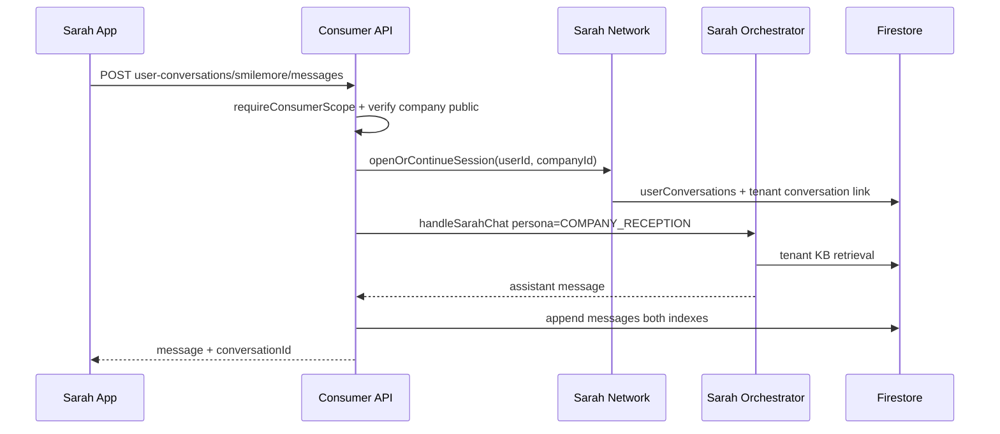

# Sarah Network — Protocol and Service Architecture

**Scope:** Controlled communication between **Personal Sarah**, **Company Sarah**, and (future) other AI employees.

Sarah Network is **not** arbitrary service-to-service RPC between tenants. It is a **mediated message bus** with identity, consent, rate limits, and audit.

---

## Interaction types

| Type | Initiator | Example |
|------|-----------|---------|
| `person_to_personal` | User | My Sarah chat |
| `person_to_company` | User | Chats UI → SmileMore Sarah |
| `personal_to_company` | Personal Sarah (user authorized) | “Ask schools for admission requirements” |
| `company_to_personal` | Company Sarah | Reply to authorized enquiry only |

**Forbidden:** Company A’s Sarah calling Company B’s internal tools directly. Cross-tenant business queries go through **Discover + explicit user session**, not tenant-to-tenant backdoors.

---

## Message envelope (logical schema)

All network messages are server-authored or server-validated. Clients send **intent**, not forged network envelopes.

```json
{
  "requestId": "snr_20261104_abc123",
  "interactionType": "business_information",
  "channel": "sarah_app",
  "source": {
    "actorType": "personal_sarah",
    "userId": "firebase-uid",
    "sessionId": "personal-session-id"
  },
  "destination": {
    "actorType": "company_sarah",
    "companyId": "smilemore-demo",
    "tenantSessionId": "optional"
  },
  "payload": {
    "intent": "admission_requirements",
    "naturalLanguage": "What documents are required for Grade 1 enrolment?",
    "structured": {
      "grade": "1",
      "year": 2027
    }
  },
  "consent": {
    "grantId": "grant_xyz",
    "scope": "this_request",
    "disclosedFields": []
  },
  "createdAt": "2026-11-04T12:00:00.000Z"
}
```

### Response envelope

```json
{
  "requestId": "snr_20261104_abc123",
  "responseId": "snr_res_def456",
  "status": "completed",
  "source": {
    "actorType": "company_sarah",
    "companyId": "smilemore-demo"
  },
  "payload": {
    "naturalLanguage": "For Grade 1 we require …",
    "structured": {
      "feesZar": 45000,
      "deadline": "2026-10-31",
      "documents": ["birth_certificate", "report_card"]
    }
  },
  "policy": {
    "notAdvice": true,
    "validUntil": "2026-12-01T00:00:00.000Z"
  }
}
```

---

## Server flow (person → company chat)



---

## Sarah-to-Sarah (personal → company)

1. User asks Personal Sarah to enquire with multiple schools.
2. Personal Sarah tool `sarahNetwork.enqueueEnquiry` creates **one request per company** with `interactionType: business_information`.
3. **Consent service** validates grant (or prompts user in-app for approval).
4. Worker invokes Company Sarah orchestrator with **read-only** tool subset (`searchCompanyKnowledge`, structured FAQ tools, no CRM export).
5. Responses stored on `sarahNetwork/requests/{requestId}`.
6. Personal Sarah synthesis turn compares structured payloads → user-facing comparison (no auto-enrol).

Rate limits: per-user, per-tenant, and global cost caps.

---

## Identity and anti-spoofing

| Check | Enforcement |
|-------|-------------|
| User authenticated | Firebase token on all consumer endpoints |
| Company exists + discoverable | `businessDirectory/{companyId}.discoverability === public` |
| Company Sarah identity | Server sets `destination.companyId`; client cannot override to another tenant |
| Personal Sarah identity | Server binds `source.userId` from token |
| Consent | Grant must match `requestId` or action type |

---

## Mapping to existing conversation pipeline

WhatsApp today:

`webhook → conversationPipeline → saveInboundMessage → AI Employee / worker`

Sarah App parallel:

`sarahNetwork → saveInboundMessage (channel=sarah_app, externalUserId=uid) → Company Sarah orchestrator`

Reuse [conversationPipeline.js](../../services/integrations/conversationPipeline.js) patterns with new `channel` enum value.

Tenant inbox (Company Portal) should show Sarah App threads alongside WhatsApp when `integration.channels.sarahApp` enabled (U5).

---

## Audit

Every network request writes:

- `sarahNetwork/audit/{eventId}` — immutable event
- Link from `consents/{uid}/grants/{grantId}` when applicable
- Platform ops metrics (latency, token cost, abuse flags)

---

## API sketch (consumer namespace)

| Method | Path | Purpose |
|--------|------|---------|
| POST | `/api/user-conversations/:companyId/messages` | User → Company Sarah |
| GET | `/api/user-conversations` | Chats list |
| GET | `/api/user-conversations/:id/messages` | History |
| POST | `/api/sarah-network/enquiries` | Personal Sarah multi-company batch (server-side from personal chat) |
| GET | `/api/sarah-network/requests/:requestId` | Status + response |

Internal only (not public):

| POST | `/api/internal/sarah-network/dispatch` | Worker dispatch |

---

## Versioning

- `protocolVersion: 1` on all envelopes
- Breaking changes increment version; orchestrator supports N and N-1 during migration

---

## Pilot scope (U4–U5)

- Single-company synchronous person → company chat (no multi-hop personal → many companies)
- Then one Personal Sarah → one Company Sarah structured enquiry with consent
- Multi-school compare deferred to U6

---

## Implementation status (U4 core)

| Component | Location |
|-----------|----------|
| Consent grants | `services/users/consentGrantService.js` |
| Discoverability gate | `services/users/businessDirectoryService.js` (pilot companies via `SARAH_NETWORK_PILOT_COMPANY_IDS`) |
| Request store + audit | `services/sarah/network/sarahNetworkStore.js` |
| Dispatch | `services/sarah/network/dispatchCompanyReception.js` |
| API | `services/api/sarahNetworkRoutes.js` |

**Tests:** `test/sarah-network-u4.test.mjs`

**U5 still required:** `userConversations`, Chats UI, dual-write tenant conversations, direct user → Company Sarah messaging (not only Personal Sarah proxy).
