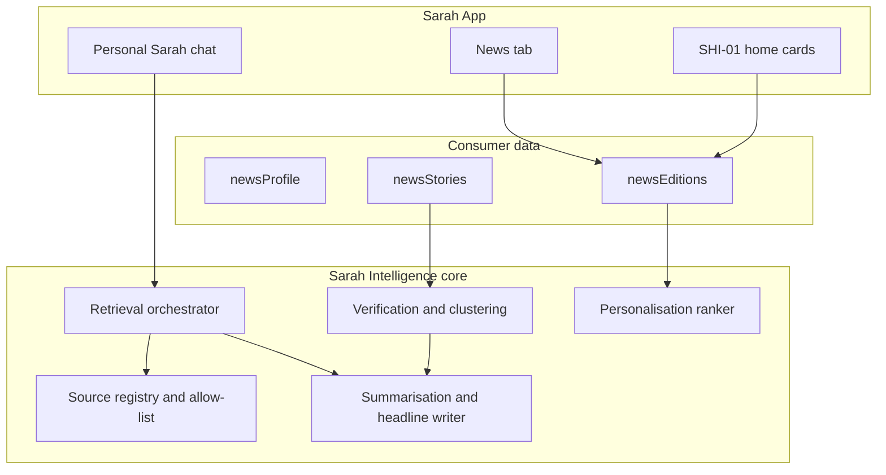

# SN-NEWS-00 — Sarah News & Intelligence (strategic direction)

**Status:** Explore / Phase 0 — architecture and UX prototype (not production news pipeline)  
**Owner:** Sarah App consumer experience  
**Principle:** One **Sarah Intelligence** engine powers Personal Sarah (on-demand) and Sarah News (proactive). No duplicate research stacks.

**Related:** [SHI-01_SARAH_HOME_INTELLIGENCE.md](./SHI-01_SARAH_HOME_INTELLIGENCE.md), [SARAH_APP_MASTER_ARCHITECTURE.md](./SARAH_APP_MASTER_ARCHITECTURE.md)

---

## 1. Objective

Make Sarah a **personal news editor and intelligence companion**: curated headlines, scheduled briefings, breaking alerts, and drill-down story rooms — inspired by legacy **Duta**-style digests, upgraded with conversational AI, source discipline, and shared platform infrastructure.

People should not chase information across apps and sites; Sarah brings **what matters** to them, when they asked to receive it.

---

## 2. Product surface (Sarah App navigation)

| Tab | Role |
|-----|------|
| **My Sarah** | Home, chat, work, intelligence cards (SHI-01) |
| **News** | Proactive digests, headline tap → story room |
| **Discover** | Businesses & organisations |
| **Chats** | Sarah Network conversations |
| **Profile** | Account, knowledge, prefs |

**Status feed** is **not** a primary Sarah App tab (SA-01). Organisation status remains portal/network where relevant; **News** replaces consumer “timeline” attention with **editorial intelligence**.

---

## 3. Delivery experiences

| Slot | Intent | Typical window (user-local) |
|------|--------|---------------------------|
| **Morning briefing** | Overnight + day-ahead context | ~07:00 |
| **Lunchtime update** | Since morning | ~12:00 |
| **Evening review** | Day’s major stories | ~18:00 |
| **Breaking** | Material events as detected | Push + in-app; not batch-only |

Users enable any combination. Breaking requires explicit opt-in and category/region match.

---

## 4. Personalisation dimensions

### 4.1 Geography (multi-select)

South Africa, Zimbabwe, Africa, World, **local community** (geofence / city when permitted — future).

### 4.2 Interests (multi-select)

Politics, Business & finance, Technology & AI, Sports, Entertainment, Health & science, Education, Mining & resources, Agriculture, Religion, Travel, Environment, Jobs, Automotive, Fashion & lifestyle, Community.

### 4.3 Follow entities (v2)

Teams, companies, people, topics — stored as structured follow rules, not free-text only.

### 4.4 Language

English, isiZulu, isiXhosa, Shona, Sesotho, … — briefing **generation language**; source articles may remain original with translated summary.

### 4.5 Conversational edits

“Sarah, remove entertainment and add mining” → updates `newsProfile` via Personal Sarah tool (same profile record as News settings UI).

---

## 5. UX: digest → story room

### 5.1 Digest (default)

- Greeting + edition label (`FRIDAY · MORNING · 07:00`).
- Region chips reflecting profile.
- Sections: **Top stories**, **Breaking** (if any), per-region blocks, per-interest blocks.
- Each item: **headline**, **Sarah summary** (2–3 lines), **source attribution** (publishers, not anonymous).
- Chips: *Explain first story*, *More Zimbabwe*, *Business headlines*, *What’s trending?* → Personal Sarah thread with context payload.

**No long article in the feed.** Tap opens **story room**.

### 5.2 Story room

- Headline, hero image (when licensed/available).
- Sarah summary + **confidence** (confirmed / developing / disputed).
- Links to source articles.
- Timestamps, “also reported by”.
- Optional background context (from knowledge + prior editions).
- **Ask Sarah** inline — follow-ups without leaving the story (`storyId` + `editionId` in chat context).

---

## 6. Breaking news intelligence (design rules)

Pipeline (async workers, not chat turn):

1. Monitor **allow-listed** source feeds/APIs/RSS (per region/category).
2. Cluster near-duplicate headlines (same event).
3. Classify: **new event** vs **update** to existing `storyId`.
4. Score significance (rules + model) per user interest graph.
5. Credibility: require **N independent publishers** or downgrade to “developing”.
6. Never present rumour as fact; label unverified clearly.
7. Push only if user opted in and story matches profile.
8. Merge updates into story room; edition may show “Updated 14:32”.

**Trust beats speed** — but speed is a feature when confidence rules pass.

---

## 7. Duta capability map → Sarah (single brain)

| Legacy Duta-style service | Sarah delivery |
|---------------------------|----------------|
| News digests | **Sarah News** tab + scheduled editions |
| Sports | News interest + optional Sports digest section |
| Entertainment / finance | Interest filters + on-demand via Personal Sarah |
| Wikipedia-style lookup | **Sarah Knowledge Search** (web + summarise) |
| Weather, currency, translate, dictionary | **Sarah Knowledge Services** tools in chat (not separate nav tabs) |
| Quizzes / games / devotionals | **Sarah Play** / **Daily inspiration** — low priority; chat-invoked |

News is the **dedicated destination**; other services stay **conversation-first** unless usage proves a tab is needed.

---

## 8. Architecture — one intelligence stack



| Layer | Responsibility |
|-------|----------------|
| **Source registry** | Publisher allow-list, RSS/API endpoints, rate limits, robots/legal flags |
| **Retrieval orchestrator** | Fetch, normalise, dedupe; shared by News jobs and Personal Sarah research tools |
| **Edition compiler** | Scheduled morning/lunch/evening jobs + manual “Refresh my news” |
| **Story service** | Stable `storyId`, versions, citations |
| **Personal ranker** | Order headlines using `newsProfile` + SHI signals (quiet hours, work mode) |
| **Notification bridge** | FCM + in-app; reuse SNA prefs; breaking channel separate |

**SHI-01 integration:** Home card templates e.g. `news.morning_ready`, `news.breaking` with deep link `#news` or `#news/story/:id`. Same engine; card is a **pointer**, not a second feed.

---

## 9. API sketch (consumer)

| Method | Path | Purpose |
|--------|------|---------|
| GET/PUT | `/api/personal-sarah/news/profile` | Regions, interests, briefings, breaking, language |
| GET | `/api/personal-sarah/news/editions/latest` | Query: `slot=morning\|lunch\|evening\|breaking` |
| GET | `/api/personal-sarah/news/stories/:storyId` | Story room payload |
| POST | `/api/personal-sarah/news/compile` | On-demand compile (rate limited; US-04 tokens) |
| POST | `/api/personal-sarah/news/stories/:storyId/ask` | Optional: start thread with story context |

All routes: `consumerAuth`, profile scoped to `uid`. No tenant data in News v1.

---

## 10. Data model (Firestore / memory v1)

```
users/{uid}/newsProfile { regions[], interests[], briefings{}, breaking, language, updatedAt }
users/{uid}/newsEditions/{editionId} { slot, compiledAt, headlineRefs[], status }
users/{uid}/newsStories/{storyId} { headline, summary, confidence, sources[], image, clusterKey, updatedAt }
```

Breaking pushes reference `storyId` + `editionId` for deep link.

---

## 11. Phased delivery

| Phase | Scope | Exit criteria |
|-------|--------|---------------|
| **SN-00** | This doc + UX prototype (mock editions) | Nav + setup + story room UI sign-off |
| **SN-01** | Profile API + static/RSS pilot (SA + ZW) | Real morning edition for test users |
| **SN-02** | Story room + Ask Sarah context | Follow-up questions cite sources |
| **SN-03** | Lunch/evening schedulers + push | Three slots reliable 7 days |
| **SN-04** | Breaking detector + confidence | No false “BREAKING” in acceptance suite |
| **SN-05** | Entity follows + Duta-style chat tools | Weather/currency/translate unified in tool registry |
| **SN-06** | Publisher partnerships / sponsorship policy | Legal review; ads labelled |

**Do not** launch SN-04 before credibility rules are tested.

---

## 12. Non-goals (v1)

- Scraping paywalled content in full text.
- User-generated “news” posts (that was Status).
- Autonomous publishing as a news outlet without legal sign-off (SN-06).

---

## 13. Compliance & trust

- POPIA: profile and reading history are user data; export/delete with consumer account.
- Attribution: every summary links sources.
- Political/sensitive: no fabricated quotes; summaries must be traceable.
- Children: breaking push off by default for minor accounts (future).

---

## 14. Prototype (SN-00)

- `prototype/sarah-app-ux/js/sarah-news.js` — local prefs + **illustrative** headlines (not live journalism).
- News tab in bottom nav between My Sarah and Discover.
- Labels: “Illustrative preview — not actual news reports.”

---

## 15. Open decisions for Spencer / Astra

1. **Source allow-list v1** — which SA/ZW publishers (public RSS/API only)?  
2. **Breaking default** — off until SN-04, or soft-launch to internal testers?  
3. **Token metering** — does each scheduled edition count against US-04 allowance?  
4. **Community local news** — city feed source or manual curator?  
5. **Monetisation** — sponsored headline slots vs subscription-only (defer SN-06).

---

*Challenged to Excel — bring the world’s signal to the user, with Sarah as editor, not echo chamber.*