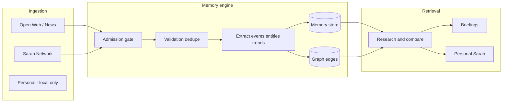

# SWI-00 — Sarah World Intelligence & Intelligence Memory

**Status:** Strategic foundation agreed · **SWI-M0** scaffolding in repo  
**Owner:** Sarah platform (Personal Sarah, News, Discover, Company Sarah)  
**Principle:** We are not building another search engine or news aggregator. We are building an **intelligence platform** that understands information, remembers developments, recognises relationships, and supports better-informed decisions.

**Related:** [SN-NEWS-00](./SN-NEWS-00_SARAH_NEWS_INTELLIGENCE.md), [SHI-01](./SHI-01_SARAH_HOME_INTELLIGENCE.md), [SARAH_APP_MASTER_ARCHITECTURE.md](./SARAH_APP_MASTER_ARCHITECTURE.md), [SWI-01 programme phases](./SWI-01_PROGRAMME_PHASES.md)

---

## 1. Sarah Intelligence Memory vs ordinary search

| Mode | Behaviour |
|------|-----------|
| **Ordinary web search** | User asks → Sarah retrieves current articles → answers once. |
| **Sarah with Intelligence Memory** | Sarah holds **organised history** by domain, entity, and timeline → on ask, she merges **current retrieval** with **stored developments** and can explain what changed, why it matters, and what might happen next (with uncertainty). |

Example — *"What is happening in Zimbabwe's mining industry?"*

- **Now:** RSS/Open Web (Pillar 2) via Sarah News edition compile.
- **Memory (Pillar 4):** Prior mining regulation, project, and commodity observations admitted under provenance rules.
- **Output:** Now · before · delta · significance · cautious outlook.

---

## 2. Four information pillars

| # | Pillar | Role |
|---|--------|------|
| **1** | **Sarah Network** | Participating businesses, Company Sarah, products, services, permissioned business knowledge. |
| **2** | **Open Web Intelligence** | News publishers (SN-06), research, public databases, allow-listed RSS/API. |
| **3** | **Personal Knowledge** | User prefs, saved items, authorised personal context (never shared across users). |
| **4** | **Sarah Intelligence Memory** | Structured **historical** layer: events, entities, relationships, trends, timelines — built from **admitted** signals from pillars 1–3, not a copy of the whole web. |

Personal Sarah coordinates all four via **Sarah Intelligence Router** (existing pattern: News compile, KB search, network tools — to be unified under `services/sarah/intelligence/`).

Pillar 4 is **not** an independent source of truth; it is **derived, structured, provenance-linked** intelligence.

---

## 3. Seven memory domains

| Domain | ID | Examples |
|--------|-----|----------|
| Global events | `global_events` | Elections, conflicts, disasters, major policy |
| Industry | `industry` | Mining, auto, health, education, energy, … |
| People & organisations | `entities` | Companies, gov departments, public figures (public facts only) |
| Economic & market | `economy` | Inflation, FX, commodities, budgets (value + unit + date + source) |
| Technology & innovation | `technology` | AI, products, regulation, breakthroughs |
| Trends | `trends` | Emergent patterns with evidence strength & geography |
| Historical context | `history` | Links current developments to prior recorded events |

Each stored record carries: **provenance**, **admittedAt**, **confidence**, **supersedes** / version, **geo**, **industry tags**, **entity refs**.

**Never** store unverified allegations as facts.

---

## 4. Memory types (privacy firewall)

| Memory | Owner | Must not… |
|--------|-------|-----------|
| Personal Knowledge | User | Leak to other users |
| Company Knowledge | Tenant | Enter shared memory without publication / network permission |
| Sarah Network Knowledge | Network ACL | Override tenant privacy |
| **Sarah Intelligence Memory** | Platform (public developments) | Absorb private customer PII or sealed company data |

---

## 5. Intelligence Memory Engine (logical)

### Admission process (mandatory)

1. Retrieve candidate signal.  
2. Identify event / subject / entities.  
3. Source quality check.  
4. Independent corroboration where policy requires.  
5. **New vs duplicate** (story cluster id).  
6. Long-term relevance score.  
7. Store structured record + source refs.  
8. Update or supersede existing records.

Not every RSS item is admitted — see `sarahIntelligenceMemoryAdmission.js`.

---

## 6. Intelligence graph (SWI-M2+)

Typed relationships, e.g. `Country` → `contains` → `Industry` → `related_development` → `Event`.

Used for: research, comparisons, trend detection, multi-hop questions.

Initial schema sketch in `sarahIntelligenceGraphTypes.js` (M0).

---

## 7. Sarah World Monitor (hybrid — agreed)

| Layer | Scope |
|-------|--------|
| **Central** | Major global, Africa, SA/ZW, economies, tech, business, science, politics, sport (headline tier), emergencies |
| **Personal** | User follow topics / entities (existing `followTopics` + profile interests) |

**Feeds:** Sarah Intelligence Memory + Sarah News (editions, breaking, home cards SHI-01).

**Default recommendation:** Hybrid — central efficiency + personal relevance.

Implementation: `sarahWorldMonitorService.js` (M0 tick behind `SARAH_WORLD_MONITOR_ENABLED`, default off).

---

## 8. Sarah Intelligence Briefings (SWI-M3+)

Higher-level reports from memory + current web, e.g. Zimbabwe Economic Outlook, African Mining Intelligence — distinct from daily News slots (longer, evidence tables, risks/opportunities).

Product: consumer + **business intelligence** entitlements on ZiricAI.

---

## 9. Platform component map (target)

| Component | Role |
|-----------|------|
| **Sarah Intelligence** | Shared ecosystem intelligence |
| **Sarah Intelligence Router** | Source selection & coordination |
| **Sarah Intelligence Memory** | Historical structured store |
| **Sarah Intelligence Graph** | Entity–event relationships |
| **Sarah Research** | Current + historical Q&A |
| **Sarah Proactive Intelligence** | Schedulers, breaking, home cards |
| **Sarah News** | Headlines, story room, push |
| **Sarah World Monitor** | Central + delegated personal monitoring |
| **Personal Sarah** | Conversational interface |

---

## 10. Current repo anchors (R1 → SWI)

| Today | SWI evolution |
|-------|----------------|
| `sarahNewsEditionService` | Open Web ingestion → memory admission hook |
| `sarahNewsIntelligenceService` | Router surface for Personal Sarah |
| `sarahHomeIntelligenceService` | Proactive cards from News snapshot |
| `retrieveAgentKnowledgeContext` | Pillar 1 company KB |
| Consumer `newsProfile` / `followTopics` | Personal monitoring inputs |

**Code (M0):** `services/sarah/intelligence/` — admission, memory store interface, world monitor tick stub, graph types.

---

## 11. Open decisions (Spencer / Astra)

1. **Storage:** Firestore collections vs dedicated graph DB for M2.  
2. **Corroboration:** Minimum publishers before `trend` promotion.  
3. **Retention:** TTL per domain (events vs commodity time series).  
4. **Commercial:** Which briefings ship on Free vs Premium vs Business.  
5. **Company → shared memory:** Explicit publish workflow (portal toggle).

---

*Challenged to Excel — Sarah remembers the world responsibly, not infinitely.*