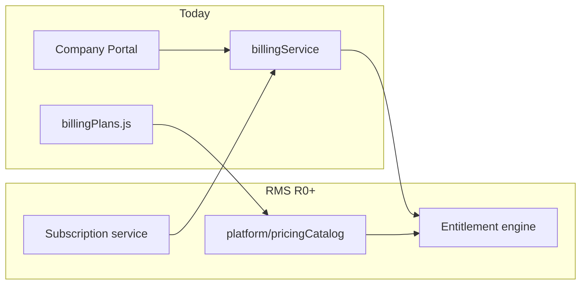
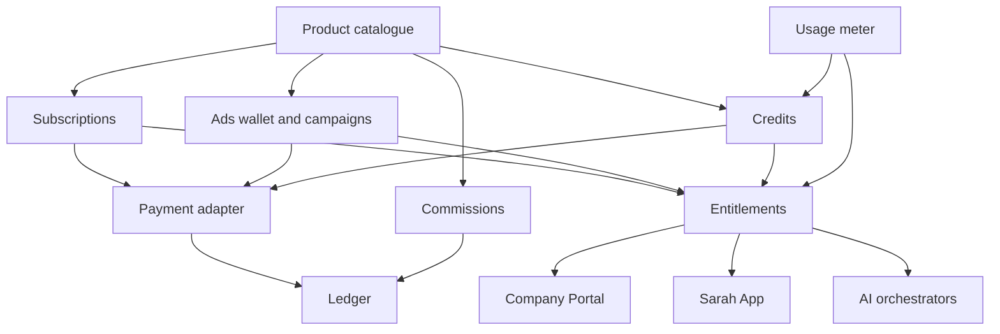

# ZiricAI — Revenue Management System Implementation Specification

**Document:** `ZIRICAI_REVENUE_MANAGEMENT_IMPLEMENTATION_SPEC.md`  
**Version:** 1.0  
**Status:** Approved for gated foundation build — **no new production charges until commercial activation sign-off**  
**Related:**

- [ZIRICAI_REVENUE_ARCHITECTURE.md](./ZIRICAI_REVENUE_ARCHITECTURE.md) — commercial RS01–RS08  
- [ZIRICAI_REVENUE_SYSTEM_ARCHITECTURE.md](./ZIRICAI_REVENUE_SYSTEM_ARCHITECTURE.md) — logical architecture & codebase audit  
- [SARAH_APP_MASTER_ARCHITECTURE.md](./SARAH_APP_MASTER_ARCHITECTURE.md) — consumer product (U0 gate independent of revenue build)

---

## 0. Purpose and gates

### 0.1 Purpose

Define **how** ZiricAI implements a single **Revenue Management System (RMS)** as a platform capability: catalogue, subscriptions, entitlements, usage, advertising, commissions, credits, payments, ledger, and Mission Control reporting.

This spec is the engineering contract **before** R0 implementation. It does not activate billing in production.

### 0.2 Programme gates (mandatory)

| Gate | Rule |
|------|------|
| **Sarah App U0** | Consumer identity, data boundaries, and Trust & Consent remain governed by Sarah architecture docs. Revenue complements U0; it does not bypass U0 sign-off or merge consumer data into tenant paths. |
| **Architecture vs activation** | All eight revenue streams are **designed and schema-ready** in Phase 1 architecture work. **Commercial activation** follows product readiness (see §0.3). |
| **No surprise charges** | Payment provider checkout, webhooks that grant paid entitlements, and paywalls are behind **`revenue.commercialActivation.*`** flags (§5). Default: **off** in production until operator sign-off. |
| **Tenant continuity** | Existing `companies/{companyId}/billing/*` records and trial-on-provision behaviour **continue unchanged** until an explicit migration window (§9). |

### 0.3 Architecture readiness vs commercial activation

| Stream | Architecture (design + hooks + schema) | Commercial activation |
|--------|----------------------------------------|------------------------|
| **RS01** Company subscriptions | Phase 1 (R0–R1) | Phase 1 — when payments + dunning validated |
| **RS02** Sarah subscriptions | Phase 1 (R0–R1) | After consumer usage validation (metrics + COGS) |
| **RS03** Status Boost | Phase 1 (R0) | When Status product is operational (U7) |
| **RS04** Discover sponsored | Phase 1 (R0) | When Discover is operational (U6) |
| **RS05** Transaction commissions | Phase 1 design (R0 ledger types) | Phase 2 — Sarah Network checkout |
| **RS06** AI credits | Phase 1 design (R0 meter + credit schema) | Phase 2 — metering mature |
| **RS07** Premium add-ons | Phase 1 design (catalogue SKUs) | Phase 2 |
| **RS08** Enterprise services | Phase 1 design (quote/contract types) | Phase 3 |

**Principle:** One RMS codebase; **feature flags** control which streams enforce limits and collect money.

---

## 1. Existing billing infrastructure — reuse and boundaries

### 1.1 Inventory (current repo)

| Component | Location | Maturity | Reuse strategy |
|-----------|----------|----------|----------------|
| Plan catalogue (company) | `services/platform/billingPlans.js` | Medium | **Migrate** to central catalogue; keep JS module as **read-through adapter** during transition |
| Tenant billing record | `services/payments/billingService.js` → `companies/{id}/billing/` | Low–medium | **Keep** as RS01 subscription **instance** store until unified `revenueSubscriptions` backfill |
| Plan limit checks | `checkPlanLimit`, `checkCompanyLimit` | Partial | **Wrap** with entitlement engine; extend resources metered |
| AI employee enforcement | `services/tenants/aiEmployeeEntitlement.js` | Medium | **Call** entitlement engine when `revenue.entitlements.enforceCompany` enabled |
| Trial on provision | `provisioningService.js` → `createTrialSubscription` | Medium | **Unchanged** behaviour; emit ledger `subscription.trial_started` when ledger live |
| Public plan API | `GET /api/billing/plans`, `check-limit` in `api/app.js` | Medium | **Deprecate gradually**; new reads from `/api/revenue/catalogue/*` |
| Portal billing UI | `js/portal/modules/billing.js` | Medium | Continue RS01 UX; swap data source to RMS APIs |
| Browser plan mirror | `js/shared/billingPlans.browser.js` (copied per site) | Low | **Remove duplication** — fetch catalogue from API only |
| MC billing read model | `getPlatformBillingConsole`, `viewPlatformBillingConsole` | Read-only tenant plans | **Extend** to platform ledger + all RS streams |
| Tenant finance (invoices, GL) | Tenant-scoped finance modules | Medium | **Not** RS05; remain customer accounting inside company |
| Marketplace pack entitlements | `schema.js` marketplace paths | Medium | Map to RS07 add-on SKUs in catalogue |

### 1.2 What not to reuse as-is

- **Do not** store consumer subscriptions under `companies/{id}/billing/`.
- **Do not** embed feature logic in payment webhooks beyond “record payment → enqueue entitlement refresh”.
- **Do not** duplicate prices in marketing, portal, admin, and users site bundles — single catalogue API.

### 1.3 Reuse pattern (strangler fig)



Phase R0: catalogue + entitlements **read** from both legacy plan id and new SKU id (alias map).  
Phase R1: write path for new subscriptions goes through RMS; legacy fields mirrored for rollback.

---

## 2. Unified product and pricing catalogue

### 2.1 Requirements

- **Single source of truth** for every monetised SKU across RS01–RS08.
- **Versioned** price lists (effective `validFrom`, optional `validTo`); existing contracts pin to **price version id**.
- **Regional** price lists (country, currency, tax profile) without code deploy.
- **Entitlement template** per SKU (limits, feature flags, model tiers) — not embedded in apps.

### 2.2 Product identifier scheme

| Field | Example | Notes |
|-------|---------|-------|
| `productId` | `rs01.company.starter` | Stable logical product |
| `skuId` | `rs01.company.starter.zar.monthly` | Billable SKU |
| `revenueStreamId` | `RS01` | Register alignment |
| `accountTypes` | `company` \| `consumer` \| `both` | RS06 may be both |

Advertising and credits use **product families**:

- RS03: `rs03.status.boost.starter`, `rs03.status.boost.custom`  
- RS04: `rs04.discover.featured.basic`, `rs04.discover.search.campaign`  
- RS06: `rs06.credits.consumer.500`, `rs06.credits.company.5000`  
- RS07: `rs07.addon.whatsapp_business`  
- RS08: `rs08.service.enterprise_implementation`

### 2.3 Firestore layout (proposed)

```
platform/pricingCatalog/
  meta/currentVersionId
  versions/{versionId}/
    publishedAt, publishedBy, status: draft|published|archived
    products/{productId}/
      revenueStreamId, name, description, accountTypes
      skus/{skuId}/
        currency, amountCents, billingPeriod, trialDays
        entitlementTemplateId
        regions[] // optional allow-list
        providerPriceIds: { stripe?, paystack? }
  entitlementTemplates/{templateId}/
    limits: { aiEmployees, conversations, ... }
    features: { discoverAds: false, ... }
    sarahLimits: { dailyChats, knowledgeBytes, ... }  // RS02
```

### 2.4 Catalogue service API (proposed)

| Method | Path | Auth | Purpose |
|--------|------|------|---------|
| GET | `/api/revenue/catalogue/public` | Public | Marketing + Sarah upgrade pages (filtered) |
| GET | `/api/revenue/catalogue/skus/:skuId` | Authenticated | Checkout preview |
| GET | `/api/platform/revenue/catalogue/versions` | MC superadmin | Draft/publish |
| POST | `/api/platform/revenue/catalogue/versions` | MC superadmin | Create draft |
| POST | `/api/platform/revenue/catalogue/versions/:id/publish` | MC superadmin | Atomic publish |

**Publish rule:** Publishing creates immutable version; running subscriptions reference `skuId + priceVersionId`.

### 2.5 Migration from `billingPlans.js`

1. Export current `BILLING_PLANS` to seed JSON (`rs01.company.trial`, `rs01.company.starter`, …).  
2. Map legacy `planId` → `skuId` in `platform/pricingCatalog/legacyAliases`.  
3. Entitlement engine resolves: `planId` (legacy) OR `activeSkuId` (RMS).  
4. Reconcile **list prices** with commercial doc (R499 Starter proposal vs R999.99 live) in **draft** catalogue only until commercial sign-off.

---

## 3. Revenue ledger and financial event structure

### 3.1 Design principles

- **Append-only** ledger at platform scope (no in-place edits; corrections via reversing entries).  
- Every monetary event links to **revenue stream**, **product/sku**, **account** (company or consumer), and **payment reference** when applicable.  
- Distinguish **booked**, **invoiced**, **collected**, **refunded**, **commission**, **deferred** (reporting dimensions, not double-counting).

### 3.2 Ledger document (`platform/revenueLedger/{eventId}`)

| Field | Type | Required | Description |
|-------|------|----------|-------------|
| `eventId` | string | Y | UUID |
| `eventType` | enum | Y | See §3.3 |
| `revenueStreamId` | RS01–RS08 | Y | |
| `skuId` | string | N | |
| `productId` | string | N | |
| `accountType` | `company` \| `consumer` | Y | |
| `accountId` | string | Y | `companyId` or `uid` |
| `companyId` | string | N | For B2B or commission context |
| `uid` | string | N | For B2C |
| `grossAmountCents` | int | Y | |
| `taxAmountCents` | int | N | |
| `feeAmountCents` | int | N | Payment processor |
| `netAmountCents` | int | Y | Platform net (definition in finance policy) |
| `currency` | ISO 4217 | Y | |
| `quantity` | number | N | Credits, seats |
| `paymentProvider` | string | N | |
| `paymentProviderRef` | string | N | |
| `paymentStatus` | enum | Y | `pending`, `succeeded`, `failed`, `refunded`, `disputed` |
| `subscriptionId` | string | N | |
| `campaignId` | string | N | RS03/RS04 |
| `transactionId` | string | N | RS05 |
| `creditLotId` | string | N | RS06 |
| `contractId` | string | N | RS08 |
| `metadata` | map | N | Non-PII campaign ids, etc. |
| `idempotencyKey` | string | Y | Webhook dedup |
| `createdAt` | timestamp | Y | |
| `recordedBy` | string | Y | `system`, `webhook`, `mc_admin:{uid}` |

### 3.3 Event types (initial set)

| eventType | Stream | Trigger |
|-----------|--------|---------|
| `subscription.created` | RS01/RS02 | Checkout success |
| `subscription.renewed` | RS01/RS02 | Billing cycle |
| `subscription.upgraded` / `downgraded` | RS01/RS02 | Plan change |
| `subscription.canceled` | RS01/RS02 | Cancel |
| `subscription.trial_started` | RS01 | Provision |
| `payment.succeeded` / `payment.failed` | All | Provider webhook |
| `refund.issued` | All | Support / provider |
| `ad.wallet.topup` | RS03/RS04 | Company wallet |
| `ad.campaign.charged` | RS03/RS04 | Campaign spend |
| `credit.purchased` / `credit.consumed` | RS06 | Purchase / meter |
| `commission.earned` | RS05 | Completed facilitated tx |
| `commission.reversed` | RS05 | Refund/cancel |
| `addon.activated` | RS07 | Add-on billing |
| `enterprise.invoice.issued` | RS08 | Manual/contract milestone |

### 3.4 Idempotency and reconciliation

- Webhook handlers **must** use `idempotencyKey = providerEventId`.  
- Nightly job: provider settlement vs ledger `payment.succeeded` (MC alert on mismatch).  
- Consumer and company events in **same ledger collection**, filtered by `accountType` and `revenueStreamId`.

---

## 4. Subscription and entitlement architecture

### 4.1 Separation of concerns

| Layer | Responsibility | Must not |
|-------|----------------|----------|
| **Subscription service** | Contract state: sku, period, status, provider ids, cancel at period end | Encode feature matrices |
| **Payment adapter** | Checkout, webhooks, refunds | Write entitlements directly |
| **Entitlement engine** | Effective limits & features for `companyId` or `uid` | Process card charges |
| **Usage meter** | Consumption counters, credit drawdown | Change subscription sku |

**Flow:** `payment.succeeded` → ledger → **EntitlementRefreshJob** → writes derived snapshot.

### 4.2 Subscription storage

**Company (RS01) — transition:**

- **Now:** `companies/{companyId}/billing/{docId}` with `planId`, `status`, `usage`.  
- **Target:** `revenue/subscriptions/companies/{companyId}` canonical + optional mirror to legacy doc for portal compatibility.

**Consumer (RS02):**

- `revenue/subscriptions/consumers/{uid}`  
- Denormalized `userProfiles/{uid}.commercial.sarahSkuId` and `planStatus` for fast Sarah bootstrap only (not source of truth).

### 4.3 Entitlement snapshot (derived, cache)

```
revenue/entitlements/companies/{companyId}
revenue/entitlements/consumers/{uid}
```

Fields (examples):

- `computedAt`, `catalogueVersionId`, `subscriptionSkuId`, `status`  
- `limits`: merged template + add-ons + overrides  
- `features`: booleans (e.g. `personalSarah.premiumModels`)  
- `creditsBalance` (RS06)  
- `adWalletBalanceCents` (RS03/RS04)  
- `graceUntil` (failed payment)

**TTL:** Recompute on subscription change, catalogue publish, add-on change, credit purchase, webhook, or max staleness 15 minutes.

### 4.4 Entitlement API (proposed)

| Method | Path | Scope |
|--------|------|-------|
| GET | `/api/revenue/entitlements/me` | Consumer |
| GET | `/api/revenue/entitlements/company` | Tenant admin |
| POST | `/api/revenue/entitlements/evaluate` | Internal services (or shared lib) |

Personal Sarah (`personalSarahOrchestrator`), My Knowledge, Discover/Status ad injection, and `aiEmployeeEntitlement` **call evaluate** (in-process library first; HTTP when extracted).

### 4.5 Enforcement modes

| Mode | Behaviour |
|------|-----------|
| `shadow` | Log would-block; allow action (R0 default for new limits) |
| `soft` | Warn + track; allow (pilot) |
| `hard` | Block with 402/403 + upgrade CTA |

Controlled per stream via flags (§5).

---

## 5. Feature flags and activation controls

### 5.1 Configuration store

```
platform/revenueConfig/
  commercialActivation: {
    rs01CompanyCheckout: false,
    rs02SarahCheckout: false,
    rs03StatusBoost: false,
    rs04DiscoverAds: false,
    rs05Commissions: false,
    rs06Credits: false,
    rs07Addons: false,
    rs08EnterpriseBilling: false
  }
  enforcement: {
    rs01Limits: shadow|soft|hard,
    rs02Limits: shadow,
    rs06Credits: shadow
  }
  payments: {
    provider: paystack|stripe|none,
    testMode: true
  }
```

**Authority:** Mission Control superadmin + `PLATFORM_API_KEY` automation; changes append to `platform/revenueConfig/auditLog`.

### 5.2 Runtime access

- Server reads config at request start (cached 60s) from Firestore.  
- Env override **`REVENUE_COMMERCIAL_OVERRIDE=disabled`** forces all checkout off (incident kill switch).  
- Sarah App and Portal **show** upgrade UI only when respective `commercialActivation` true **and** catalogue published.

### 5.3 Hook points without activation

Even when checkout is off, R0 should:

- Attach `entitlementSnapshot` (Free / trial defaults) to consumer bootstrap and personal chat responses.  
- Record **usage** in shadow mode for COGS dashboards.  
- Accept ledger writes in **`dryRun: true`** from staging tests.

---

## 6. How the eight revenue streams connect to RMS



| Stream | Catalogue SKUs | Subscription | Wallet/campaign | Meter/credits | Ledger events |
|--------|----------------|--------------|-----------------|---------------|---------------|
| RS01 | Company tiers | Yes | — | Plan limits | subscription.*, payment.* |
| RS02 | Sarah tiers | Yes | — | Daily chats, storage | subscription.*, payment.* |
| RS03 | Boost packages | — | Optional wallet | Impressions cap | ad.campaign.* |
| RS04 | Featured/search | — | Optional wallet | Placement slots | ad.campaign.* |
| RS05 | Commission rules | — | — | — | commission.* |
| RS06 | Credit packs | — | — | Balance | credit.* |
| RS07 | Add-ons | Add-on sub | — | Usage add-ons | addon.* |
| RS08 | Services | Contract | — | — | enterprise.invoice.* |

**Advertising wallet (recommended):** Single `adWalletBalanceCents` per company; RS03 and RS04 campaigns draw down with separate `campaignId` analytics.

---

## 7. Mission Control — administration and reporting

### 7.1 Admin capabilities (phased)

| Capability | Phase | Notes |
|------------|-------|-------|
| View consolidated revenue dashboard | R1 | MRR, by stream, collected vs booked |
| Publish pricing catalogue version | R0 | Draft → publish with approval |
| Toggle commercial activation flags | R0 | Audit logged |
| Company subscription override (support) | R1 | Time-boxed entitlement override with reason |
| Consumer plan override | R2 | Same pattern |
| Ad campaign moderation | R1b | When RS03/RS04 live |
| Ledger export (CSV) | R1 | Finance |
| Reconciliation alerts | R1 | Provider vs ledger |

### 7.2 API namespace

- `/api/platform/revenue/*` — superadmin session or platform API key (same pattern as `platformAuth.js`).  
- Extend Sarah MC tools: `viewPlatformRevenueDashboard` (new) alongside `viewPlatformBillingConsole`.

### 7.3 KPIs (read models)

Source: `platform/revenueLedger` + subscription snapshots + shadow usage.

- MRR/ARR split RS01 vs RS02  
- Ad revenue RS03+RS04, wallet balance aggregate  
- GMV & commission RS05 (Phase 2)  
- Credit sales vs consumption RS06  
- Free→paid, churn, ARPU (Sarah)  
- COGS per tier (AI meter ÷ active users)

---

## 8. Security, tenant isolation, and financial auditability

### 8.1 Authorization

| Actor | Access |
|-------|--------|
| Consumer `uid` | Own subscription, credits, receipts; not other users |
| Tenant member | Company subscription, ad wallet, RS07 for their `companyId` only |
| Platform superadmin | Catalogue, flags, cross-tenant reporting, support overrides |
| Webhooks | HMAC-verified; no user JWT; idempotent ledger only |

**Consumer scope:** `requireConsumerScope()` for all `/api/revenue/*` consumer routes — same as Sarah U1.

**No cross-tenant:** Commission and ad reports always include `companyId` filter from auth context.

### 8.2 Firestore rules (direction)

- `platform/revenueLedger`: **no client write**; Admin SDK only.  
- `platform/pricingCatalog`: read public SKUs; write MC only.  
- `revenue/subscriptions/consumers/{uid}`: read/write owner uid only.  
- `revenue/entitlements/*`: read owner; write server only.

### 8.3 Audit

- All MC changes to catalogue, flags, overrides → `platform/revenueConfig/auditLog`.  
- Ledger append-only; reversing entries reference `reversesEventId`.  
- POPIA: ad targeting stores **segment ids**, not exported PII in ledger metadata.

### 8.4 Fraud and abuse

- Rate limits on checkout session creation.  
- Credit consumption **atomic** transactions (Firestore transaction or dedicated counter service).  
- Free-tier Sarah: daily caps + anomaly detection before RS02 activation.

---

## 9. Existing company billing — continuity and migration

### 9.1 Non-disruption guarantee (R0–R1)

- `createTrialSubscription` on provision **unchanged**.  
- `getCompanyPlan`, `checkCompanyLimit`, portal billing pages **continue** to read legacy paths.  
- No mass migration of `planId` until cutover checklist passed.

### 9.2 Cutover checklist (before RS01 commercial activation)

- [ ] Catalogue published with legacy alias map  
- [ ] Entitlement engine parity test: 100% match on AI employee limits vs `checkPlanLimit` for sample tenants  
- [ ] Webhook staging tested with idempotency  
- [ ] Rollback: feature flag off reverts to legacy-only reads  
- [ ] MC dashboard shows legacy + ledger side-by-side for 30-day parallel run

### 9.3 Dual-write period (recommended)

1. **R0:** Ledger dry-run + entitlements shadow.  
2. **R1a:** Dual-write subscription changes to legacy + `revenue/subscriptions/companies`.  
3. **R1b:** Portal reads entitlements from RMS; legacy `usage` synced nightly.  
4. **R1c:** Deprecate direct `planId` edits outside RMS.

---

## 10. International expansion

### 10.1 Requirements

- **Multi-currency** SKUs (`amountCents` + `currency` per sku).  
- **Regional catalogue** filters (country → available skus).  
- **Tax profiles** per region (VAT ZA first; store `taxAmountCents` on ledger).  
- **Payment provider** per region (adapter interface; one active provider per checkout).  
- **Invoices** localized (language, tax id fields, legal entity per region — config, not hardcode).

### 10.2 Data model extensions

- `platform/pricingCatalog/versions/{v}/regions/{countryCode}` → default tax profile, payment methods.  
- Ledger always stores **transaction currency**; reporting may FX-normalize to ZAR using daily rate table `platform/fxRates/{date}`.

### 10.3 Sarah vs company

- Consumer may pay in local currency when travelling; **entitlement** tied to `uid`, not phone country.  
- Company billing address determines tax for RS01/RS07/RS08.

---

## 11. Gated implementation plan

### 11.1 R0 — Foundation (no production charges)

**Build:**

- Catalogue schema + seed from `billingPlans.js` + Sarah/RS03–RS08 placeholder SKUs (draft).  
- Ledger service (append-only) + event types §3.3.  
- Entitlement engine library + shadow mode + derived cache paths.  
- `platform/revenueConfig` flags (all commercial off).  
- MC: publish catalogue (draft), view flags, ledger search (staging).  
- Legacy alias resolver.

**Acceptance:**

- Unit tests: alias map, entitlement merge, idempotent ledger write.  
- Personal Sarah returns `entitlementSnapshot` (Free defaults).  
- Zero change to trial provision behaviour.  
- Documentation cross-links updated.

**Duration estimate:** 1–2 engineering sprints (parallel to Sarah U4 allowed).

### 11.2 R1 — RS01 hardening + RS02 ready

**Build:**

- Payment adapter (staging + production credentials gated).  
- Company checkout when `rs01CompanyCheckout` true.  
- Consumer checkout plumbing when `rs02SarahCheckout` true (paywall optional).  
- Dual-write subscriptions; MC revenue dashboard v1.  
- Dunning / failed payment → grace in entitlements.

**Commercial activation:** RS01 only after checklist §9.2; RS02 after usage/COGS review.

### 11.3 R1b — RS03 / RS04 (product-dependent)

**When U6/U7 ship:** Ad wallet, campaigns, feed/search injection, labelled sponsored content, campaign analytics, ledger integration.

### 11.4 R2 — RS05, RS06, RS07

Metering hardening, credit purchases, commission on approved Sarah Network transactions, add-on SKUs linked to catalogue.

### 11.5 R3 — RS08 + marketplaces

Quotes, milestones, enterprise invoices; optional marketplace commission extensions.

---

## 12. Service module layout (proposed repo structure)

```
services/revenue/
  catalogueService.js
  subscriptionService.js
  entitlementEngine.js
  usageMeterService.js
  creditLedgerService.js
  adCampaignService.js
  adWalletService.js
  commissionService.js
  enterpriseContractService.js
  ledgerService.js
  paymentAdapter/
    index.js
    paystackAdapter.js
    stripeAdapter.js
  revenueConfig.js
services/api/revenueRoutes.js      // company + consumer
services/api/platformRevenueRoutes.js  // MC
config/revenue/seed-catalogue.json   // generated from billingPlans migration
```

Mount in `api/app.js` without removing existing `/api/billing/*` until deprecation.

---

## 13. Testing and acceptance (RMS)

| Test | Criterion |
|------|-----------|
| Legacy parity | Same AI employee cap as before for trial/starter tenants |
| Flag off | Checkout endpoints return 503 or hidden; no provider calls |
| Flag on (staging) | End-to-end test subscription → ledger → entitlement refresh |
| Consumer isolation | Consumer subscription never grants tenant admin |
| Ad wallet | Campaign cannot overspend wallet; ledger matches |
| Refund | Reversing ledger entry; entitlement downgrade |
| Catalogue publish | Old subscriptions retain pinned `priceVersionId` |

---

## 14. Relationship to Sarah App programme

| Sarah milestone | Revenue dependency |
|-----------------|-------------------|
| U1–U3 (done) | Optional `entitlementSnapshot` in API (R0) |
| U4 Sarah Network | Design RS05 hooks; no commission charge |
| U6 Discover | RS04 architecture ready; activate when product + flag — [Sarah Status/Discover UX](./SARAH_APP_STATUS_DISCOVER_ARCHITECTURE.md) |
| U7 Status | RS03 architecture ready; activate when product + flag — sponsored timeline slots |
| U8+ bookings | RS05 activation |

Sarah feature teams **must not** implement standalone Stripe/Paystack flows in `users/` or `js/users/` — all checkout via RMS.

---

## 15. Document acceptance

This implementation spec is **ready for R0 engineering** when:

1. Stakeholder confirms architecture vs activation matrix (§0.3).  
2. Sarah U0 remains the consumer architecture gate (no conflict).  
3. Operator accepts **no production charges** until explicit `commercialActivation` toggles.  
4. Pricing remains **provisional** in catalogue **draft** until margin analysis.

**Next authorised code step:** R0 foundation behind flags (catalogue seed, ledger, entitlement shadow, MC draft publish).

---

*End of specification.*
