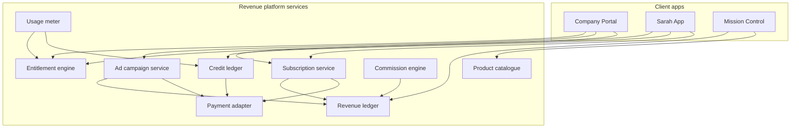

# ZiricAI — Revenue System Architecture (Technical)

**Document:** `ZIRICAI_REVENUE_SYSTEM_ARCHITECTURE.md`  
**Version:** 1.1  
**Status:** R0 foundation implemented (catalogue, entitlements shadow, ledger in-memory) — **commercial activation off**  
**Commercial spec:** [ZIRICAI_REVENUE_ARCHITECTURE.md](./ZIRICAI_REVENUE_ARCHITECTURE.md)  
**Implementation spec:** [ZIRICAI_REVENUE_MANAGEMENT_IMPLEMENTATION_SPEC.md](./ZIRICAI_REVENUE_MANAGEMENT_IMPLEMENTATION_SPEC.md)

---

## 1. Purpose

Translate the eight revenue streams (RS01–RS08) into **system boundaries**, **data ownership**, **API namespaces**, and a **read-only audit** of what exists in the repo today.

**Architectural mandates (approved):**

1. **Billing ≠ entitlements** — payment records do not embed feature logic; entitlement engine reads subscription/ad/credit state.
2. **Advertising wallet** — optional company wallet debited by RS03/RS04 campaigns.
3. **Gross margin** — meter AI COGS per tier for RS01/RS02/RS06.

---

## 2. Target logical architecture

**Namespace convention (proposed):**

| API prefix | Purpose |
|------------|---------|
| `/api/billing/*` | Legacy + company plan catalog (extend carefully) |
| `/api/revenue/subscriptions/*` | B2B + B2C subscription CRUD |
| `/api/revenue/entitlements/*` | Effective limits for uid / companyId |
| `/api/revenue/usage/*` | Metering ingest + balances |
| `/api/revenue/credits/*` | RS06 purchases & consumption |
| `/api/revenue/ads/*` | RS03 + RS04 campaigns & wallet |
| `/api/revenue/transactions/*` | RS05 commercial events |
| `/api/revenue/enterprise/*` | RS08 quotes & contracts |
| `/api/platform/revenue/*` | MC read/admin (superadmin) |

Consumer routes remain under `requireConsumerScope()`; company routes under `requireTenantScope()`.

---

## 3. Data ownership (proposed Firestore / ledger)

| Domain | Root path | Owner |
|--------|-----------|--------|
| Company subscription | `companies/{id}/billing/` (existing) + future `revenueSubscriptions` | Tenant |
| Consumer subscription | `userProfiles/{uid}.sarahPlan` + `revenue/consumerSubscriptions/{uid}` | User |
| Entitlements cache | `revenue/entitlements/companies/{id}`, `.../users/{uid}` | Platform (derived) |
| Usage meters | `companies/{id}/analytics/` + `revenue/usageEvents/` | Tenant / user |
| AI credits | `revenue/credits/{accountType}/{accountId}/balance` | Account |
| Ad wallet | `companies/{id}/adWallet` | Tenant |
| Ad campaigns | `revenue/adCampaigns/{campaignId}` | Tenant |
| Commissions | `revenue/transactions/{txId}` | Platform |
| Revenue ledger | `platform/revenueLedger/{eventId}` | Platform (append-only) |
| Pricing catalogue | `platform/pricingCatalog/` (versioned) | Platform |

**Rule:** Ledger events are **append-only**; entitlements are **computed** from subscriptions + overrides + trials.

---

## 4. Entitlement engine (dual account model)

| Account type | Key | RS streams |
|--------------|-----|------------|
| `company` | `companyId` | RS01, RS03, RS04, RS07, RS08 |
| `consumer` | `uid` | RS02, RS06 (+ RS05 as participant) |

**Inputs:**

- Active subscription SKU + period end
- Plan limits from catalogue (AI employees, messages, storage, Sarah daily chats, My Knowledge bytes)
- Active add-ons (RS07)
- Credit balance (RS06)
- Feature flags (e.g. Discover ads disabled for minor accounts — future)

**Outputs (examples):**

- `canSendPersonalSarahMessage()` → remaining daily quota
- `canPublishBoost()` → wallet balance + policy
- `canUsePremiumModel()` → plan + credits
- `maxKnowledgeSectionBytes(uid)`

**Must not:** Infer company membership from consumer plan or vice versa.

---

## 5. Stream-by-stream technical notes

### RS01 — Company subscriptions

**Today:** [billingPlans.js](../../services/platform/billingPlans.js) defines `trial`, `starter`, `professional`, … with `limits` object; [billingService.js](../../services/payments/billingService.js) stores `companies/{id}/billing/*`; [aiEmployeeEntitlement.js](../../services/tenants/aiEmployeeEntitlement.js) calls `checkPlanLimit`; Portal [billing.js](../../js/portal/modules/billing.js) UI; API `GET /api/billing/plans`, `POST /api/billing/check-limit`.

**Gap vs RS01 spec:** Growth/Enterprise SKUs, live payment provider, webhooks, dunning, annual billing, MC revenue admin (partial via Sarah tools only).

### RS02 — Sarah subscriptions

**Today:** No consumer plan field enforced; U1–U3 have no paywall.

**Needed:** `sarahPlanId` on consumer profile; Stripe/Paystack customer id; webhook handler; entitlements in Personal Sarah orchestrator before chat; My Knowledge storage caps.

### RS03 / RS04 — Advertising

**Today:** None (Status U7, Discover U6 not built).

**Needed:** Campaign entity, wallet, targeting store, feed injection with `sponsored: true`, MC moderation, POPIA audit on targeting choices.

### RS05 — Commissions

**Today:** Tenant **finance** ledger (invoices, GL) — **not** platform commission billing.

**Needed:** Sarah Network transaction id, approval grant link, payment provider callback, commission split rules.

### RS06 — Credits

**Today:** Plan `limits.tokens` in billingPlans only for companies.

**Needed:** Shared credit ledger service; operation price table; pre-flight cost estimate in Personal Sarah / Company Sarah.

### RS07 — Add-ons

**Today:** [marketplaceEntitlements](../../services/database/schema.js) for packs; WhatsApp as integration — not unified add-on SKU.

**Needed:** Add-on catalogue linked to RS01 tier eligibility.

### RS08 — Enterprise services

**Today:** Manual/offline; BOS commercial cycles partially in Sarah tools.

**Needed:** Quotes, milestones, invoices in revenue module.

---

## 6. Payment integration (South Africa first)

**Adapter interface (proposed):**

- `createCustomer({ type, id, email })`
- `createSubscription({ priceId, customerId })`
- `createPaymentIntent({ amount, currency, metadata })`
- `handleWebhook(event)` → ledger + entitlement refresh

**Providers:** Stripe and/or Paystack (existing integration hub mentions Paystack) — single adapter per environment.

**Tax:** VAT on ZAR invoices; store `taxAmount`, `taxRate` on ledger events.

---

## 7. Sarah App hooks (when RS02/RS03/RS04 activate)

| Feature | Hook point |
|---------|------------|
| Chat limit | `personalSarahOrchestrator` pre-check entitlement |
| My Knowledge size | `personalKnowledgeService.upsert` |
| Status feed | Inject sponsored posts with label + frequency cap |
| Discover | Merge organic index + sponsored slots (max N per screen) |
| Profile | Show plan, usage, upgrade, ad preferences |

---

## 8. Mission Control revenue dashboard (read models)

Aggregate from `platform/revenueLedger` + subscription snapshots:

- MRR/ARR by RS01 vs RS02
- Ad revenue RS03+RS04
- GMV & commission RS05
- Credit sales RS06
- Churn, ARPU, free→paid funnel (Sarah)

Reuse patterns from [platform billing console](../../services/sarah/tools/viewPlatformBillingConsole.js) — extend to **platform-wide** ledger, not tenant CRM billing only.

---

## 9. Read-only codebase audit summary

| Area | Maturity | Notes |
|------|----------|-------|
| Company plan catalogue | **Medium** | Rich `billingPlans.js`; prices differ from RS01 proposal doc |
| Tenant billing record | **Low–medium** | Firestore subcollection; trial creation on provision |
| Plan limit enforcement | **Partial** | AI employees; not all resources |
| Payment provider | **Low** | No production subscription webhook path verified in audit |
| Consumer billing | **None** | Sarah App pre-revenue |
| Advertising | **None** | Product not built |
| Commissions | **None** | Distinct from tenant finance module |
| AI credits | **None** | Token limits in plan object only |
| Marketplace entitlements | **Medium** | Pack installs; map to RS07 later |
| MC revenue reporting | **Read-only tenant billing** | Not consolidated RS01–RS08 |

**Conclusion:** RS01 scaffolding exists; **central Revenue Management System does not**. Sarah App monetisation requires **new consumer subscription + metering** paths without refactoring tenant billing into consumer accounts.

---

## 10. Implementation programme (technical phases)

Aligns with [ZIRICAI_REVENUE_ARCHITECTURE.md §14](./ZIRICAI_REVENUE_ARCHITECTURE.md):

| Phase | Build |
|-------|--------|
| **R0** | Catalogue schema, ledger event model, entitlement interface (stubs) |
| **R1** | RS01 payments + enforcement hardening; RS02 SKU + paywall hooks |
| **R1b** | RS03/RS04 when Status/Discover ship |
| **R2** | RS06 metering + credits; RS07 add-on SKUs |
| **R2b** | RS05 commission on Sarah Network checkout |
| **R3** | RS08 + MC dashboard |

**Non-goals during Sarah U4–U7:** Do not block Sarah Network on billing; **do** pass `entitlementSnapshot` in API responses for future limits.

---

## 11. Acceptance tests (when implemented)

- Company on Starter cannot activate RS07 add-on excluded by tier.
- Sarah Free user hits daily chat cap → 402 with upgrade path.
- Boost campaign debits wallet; ledger event RS03; feed shows sponsored label.
- Discover search returns organic + ≤N sponsored; sponsored flagged.
- Commission created only after user approval grant + captured payment.
- Credit deduction idempotent on retry.
- Refund reverses ledger and entitlements.

---

## 12. Next engineering step (when authorised)

Follow [ZIRICAI_REVENUE_MANAGEMENT_IMPLEMENTATION_SPEC.md](./ZIRICAI_REVENUE_MANAGEMENT_IMPLEMENTATION_SPEC.md):

1. **R0** — catalogue seed, ledger, entitlement engine (shadow), MC draft publish, all `commercialActivation` flags **off**.
2. **R1** — payment adapter + RS01 dual-write; RS02 checkout ready but gated.
3. **R1b** — RS03/RS04 when Status/Discover ship.

No production billing changes until explicit sign-off and payment provider credentials in Railway.
