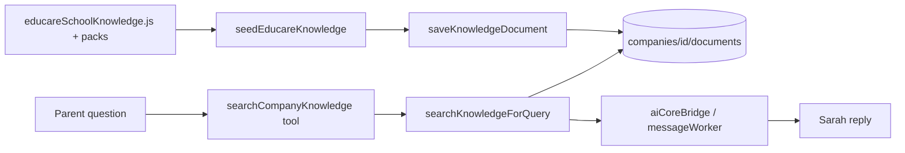

# Educare — Company Sarah knowledge ingestion and retrieval

**Programme:** Educare Sarah Knowledge Base & Admissions v1.0 (working draft)  
**Status:** Knowledge packs in repo; admissions workflow partially implemented (guardian verification only)

---

## End-to-end flow



| Step | Location | Notes |
|------|----------|--------|
| Authoritative text | `services/storage/educareSchoolKnowledge.js`, `services/storage/educareKnowledgePacksV1.js` | EDU-KB-001–007 + six packs |
| Seed | `services/education/seedEducareKnowledge.js` | On provision: `educareTenantBootstrap.js` |
| CLI seed | `scripts/seed-educare-knowledge.mjs` | `railway run` against `educare-christian-combined` |
| Persistence | `services/tenants/knowledgeService.js` → tenant `documents` | `ensureKnowledgeBase` → `kb-{companyId}` |
| Retrieval | `searchKnowledgeForQuery` (keyword RAG-lite) | `services/sarah/tools/searchCompanyKnowledge.js`, `services/ai-core/aiCoreBridge.js` |
| Sarah behaviour | `EDUCARE_SARAH_SYSTEM_PROMPT` | Updated on seed via `updateAiEmployee` |

**Not in this pipeline today:** vector embeddings, per-record approval workflow in portal, automatic supersede/expiry of document versions.

---

## Six knowledge packs (v1.0)

| Pack ID | Document id | Purpose |
|---------|-------------|---------|
| EDU-CORE | `edu-pack-core` | Identity, ethos, campuses, Sarah principles |
| EDU-CURRICULUM | `edu-pack-curriculum` | CAPS phases R–12, terminology, placement rules |
| EDU-ADMISSIONS | `edu-pack-admissions` | Parent guidance + lifecycle spec (backend gated) |
| EDU-OPERATIONS | `edu-pack-operations` | Uniform, calendar, hours, transport, activities |
| EDU-PARENT-SERVICES | `edu-pack-parent-services` | Fees, reports, meetings, complaints |
| EDU-POLICIES | `edu-pack-policies` | Safeguarding, POPIA draft, acceptance gates |

Legacy numbered docs **EDU-KB-001–007** remain for backward compatibility and portal/overview seed.

---

## Admissions capability (separate from KB)

| Layer | Status |
|-------|--------|
| Consultation + FAQ in KB | **In packs** |
| Guardian application API | **Live** — `POST /api/education/v1/orgs/:companyId/guardian-application` |
| Portal verification queue | **Live** — Parents & guardians module |
| Multi-state application lifecycle (Part C spec) | **Implemented** — `schoolAdmissionService.js`, `/api/education/v1/.../admission-applications*` |
| Company Portal admissions workspace (queues, decisions, audit) | **Implemented (pilot)** — Portal **Admissions** module; audit in `admissionAudit` |

See `docs/education/EDUCARE_SARAH_KB_ADMISSIONS_SPEC_V1.md` for the programme spec and management checklist (Part G).

---

## Operator commands

```bash
# Local test
node test/educare-school-knowledge.test.mjs

# Reseed production tenant (Firebase Admin required)
EDUCARE_COMPANY_ID=educare-christian-combined railway run node scripts/seed-educare-knowledge.mjs
```

---

## Demo script (tomorrow)

1. Ask Sarah curriculum questions (Foundation vs Intermediate, Grade 6 subjects, Grade 9 vs 10).
2. Ask admissions process questions — Sarah must **not** promise placement.
3. Walk through **admission application** (synthetic Grade 4): `users/js/educare-admissions.js` or REST sequence create → submit with `consent: true`.
4. Portal: **Admissions** workspace — queue, detail, staff transitions/decisions (pilot until management sign-off).

### Parent API (authenticated consumer)

| Method | Path |
|--------|------|
| POST | `/api/education/v1/orgs/:companyId/admission-applications` |
| PATCH | `/api/education/v1/orgs/:companyId/admission-applications/:id` |
| POST | `/api/education/v1/orgs/:companyId/admission-applications/:id/submit` |
| GET | `/api/education/v1/orgs/:companyId/my-admission-applications` |